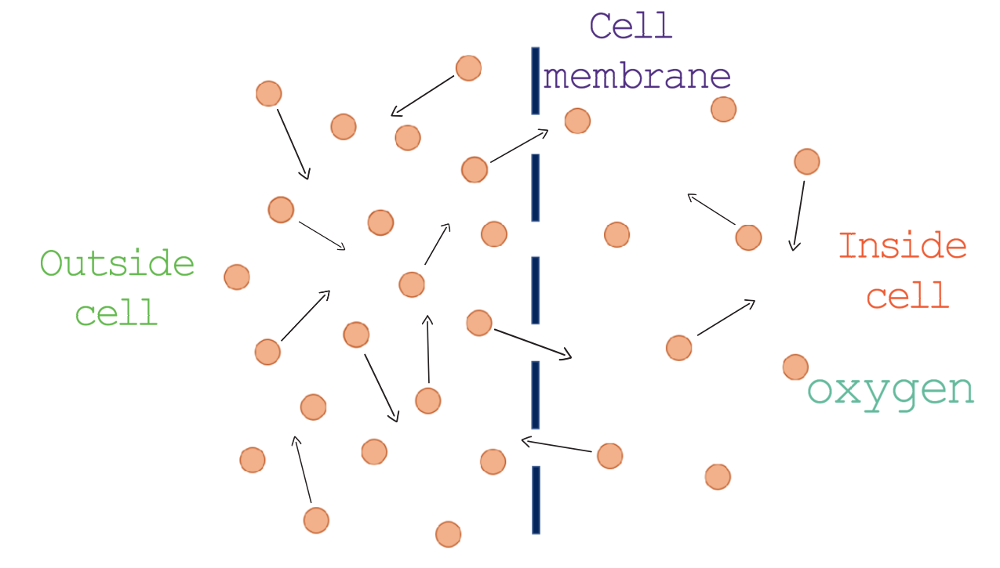

# B3: Movement into and out of cells

## Diffusion

### Definition: the net movement of molecules from a region of high concentration to a region of low concentration down a concentration gradient.

* Substances move into and out of cells via the cell membrane.

* The cell membrane is partially permeable, meaning that it only allows certain molecules into and out of the cell.

## Factors affecting diffusion:

* Temperature: as temperature increases, the rate of diffusion increases as the particles have higher kinetic energy.

* Surface area: a large surface area increases the rate at which particles diffuse.

* Distance: the shorter the distance particles have to pass through, the faster the diffusion.

* Concentration gradient: the larger the concentration gradient, the faster diffusion occurs.

*Concentration gradient is the difference between the region of high concentration gradient to a region of lower concentration gradient.