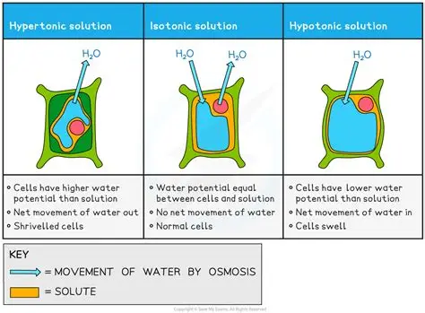

## Osmosis

Definition: the net movement of water molecules from a region of higher water potential (dilute solution) to a region of lower water potential (concentrated solution), through a partially permeable membrane.

A high water potential solution is a solution that has high concentration of water molecules, and a low water potential solution is a solution that has a low concentration of water molecules.

Imagine this: two glasses of water, in the first glass, we added one spoon of salt, that is a solution of high water potential. In the second glass, we added three spoons of salt, this classifies the solution as a low water potential solution.

## Effect of osmosis on plants

* in hypertonic solutions, water leaves the plant cell as the solution outside the plant cell is more concentrated than the solution inside the plant cell, so the plant cell becomes plasmolyzed.

* in hypotonic solutions, water enters the plant cell as the solution outside the cell is less concentrated than the solution inside the plant cell, so the plant cell becomes turgid.

* in isotonic solutions, there is no net movement of water as the solution inside the plant cell and outside the plant cell are of equal concentration. so the plant cell is flaccid. this is the perfect concentration for plant cells.

  net movement doesn’t mean no movement of water, it means that the rate of water entering the pant cell is equal to the water leaving the plant cell. it’s like a busy revolving door! people are going in and out all the time, but the total number inside stays the same.

