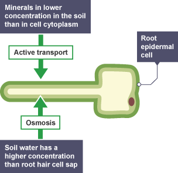

## Active transport

definition: the movement of particles through a cell membrane from a region of lower concentration to a region of higher concentration (against a concentration gradient), using energy from aerobic respiration.

active transport is crucial in living organisms as it allows the transport of important substances in living things ensuring their survival. an example you need to know is root hair cells, they take active transport to their advantage to transport mineral ions against a concentration gradient from the soil.

