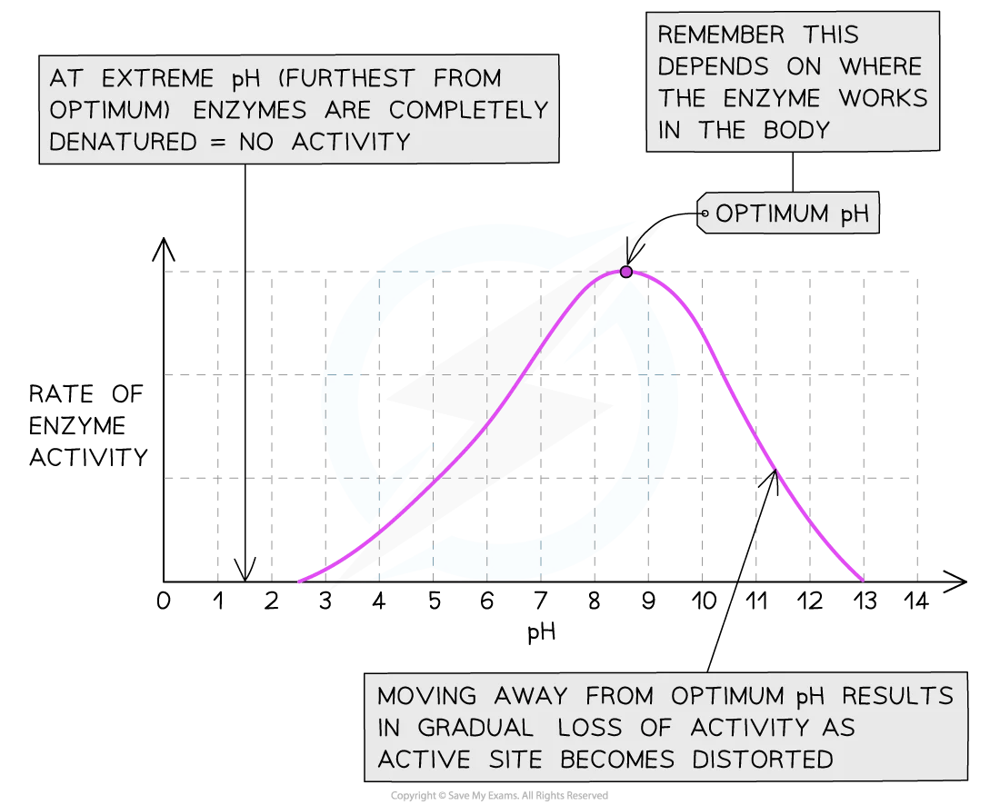

## Effect of temperature on enzyme activity

1) At low temperatures, enzymes and substrates have very little kinetic
   energy, so they move slowly and collide less often, resulting in a low rate of
   reaction.
2) As temperature increases, the kinetic energy of the molecules also
   increases, leading to more frequent successful collisions between enzyme
   and substrate, so the rate of reaction rises. The enzyme reaches its
   optimum temperature, where it works most efficiently and the rate of
   reaction is at its maximum.
3) Beyond the optimum temperature, enzymes begin to denature as their
   active sites change shape, meaning the substrate can no longer fit, and
   therefore the rate of reaction rapidly decreases until no products are
   formed.

## Effect of pH on enzyme activity

* ### At very low or very high pH, the enzyme is deactivated as the enzyme and

  substrate have very low kinetic energy, which means the rate of reaction is slow.

* ### As pH moves closer to the optimum, energy of enzyme and substrate increases so

  the rate of collision increases therefore a higher collision frequency between the
  enzyme and substrate. At the peak of the graph, this is the optimum pH which is
  the maximum activity of enzyme and substrate collision and highest functionality of
  enzymes.

* ### After the optimum pH this activity drops due to the enzymes becoming denatured

  and the active site changes shape, as a result, the enzyme can no longer function
  and no products are formed.

#|
||

factor affecting enzyme

|

description

||
||

temperature

|

As the temperature increases up to the enzyme's optimum, the rate of reaction increases. This is because the molecules have more kinetic energy, so move faster. As a result, more successful collisions occur, and more enzyme-substrate complexes can form. At a temperature above the optimum, the enzymes become denatured and the active site changes shape. So the active site is no longer complementary to the substrate. 

||
||

pH

|

enzymes have an optimum pH that they work best at. As the pH moves away from this, the rate of reaction decreases. The change in pH causes the shape of the active site to change. This means that the substrate cannot fit in the active site, hence no enzyme-substrate complexes can form. This means that the enzyme has become denatured.

||
|#

