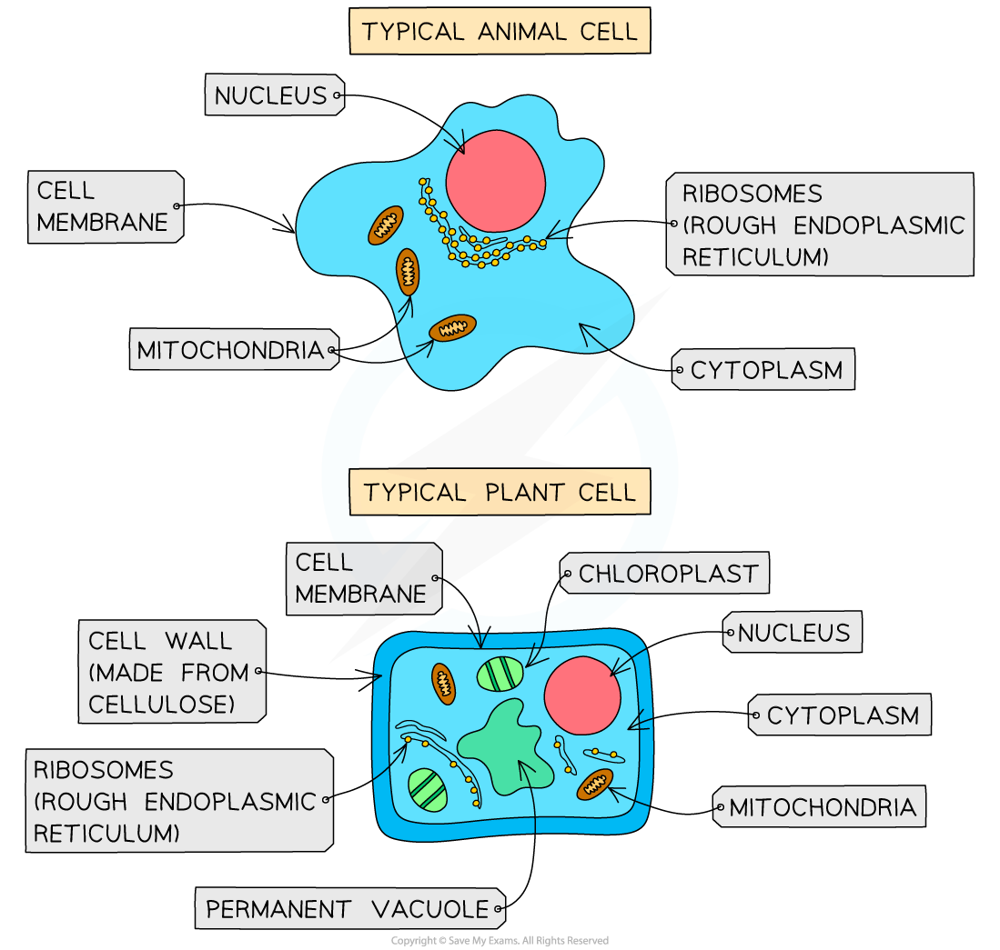
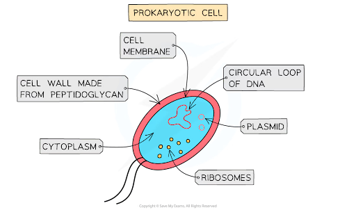

# B2: Cells

#|
||

Cell structure

|

Function/Description

|

Present in animal cells?

|

Present in plant cells?

||
||

Cell wall

|

Give the cell wall structure and prevents it from bursting.

|

no

|

yes

||
||

Cell membrane

|

Encloses the cell contents and controls what leaves and enters the cell.

|

yes

|

yes

||
||

Cytoplasm

|

A jelly like material where metabolic reactions occur.

|

yes

|

yes

||
||

Nucleus

|

Contains genetic information.

|

yes

|

yes

||
||

Chloroplasts

|

contains chlorophyll; it is where photosynthesis occurs.

|

no

|

yes

||
||

Vacuole

|

A fluid filled sac containing substances like minerals and salts. it also ensures turgor pressure in plants only.

|

no

|

yes

||
||

Ribosomes

|

Site of protein synthesis.

|

yes

|

yes

||
||

Mitochondria

|

Site of aerobic respiration, provides energy for the cell to function.

|

|

||
|#

## Bacteria cells

* Bacterial cells have a cell wall, cell membrane, cytoplasm and ribosomes. 

* Bacterial cells do not have a nucleus, instead have a circular loop of DNA.