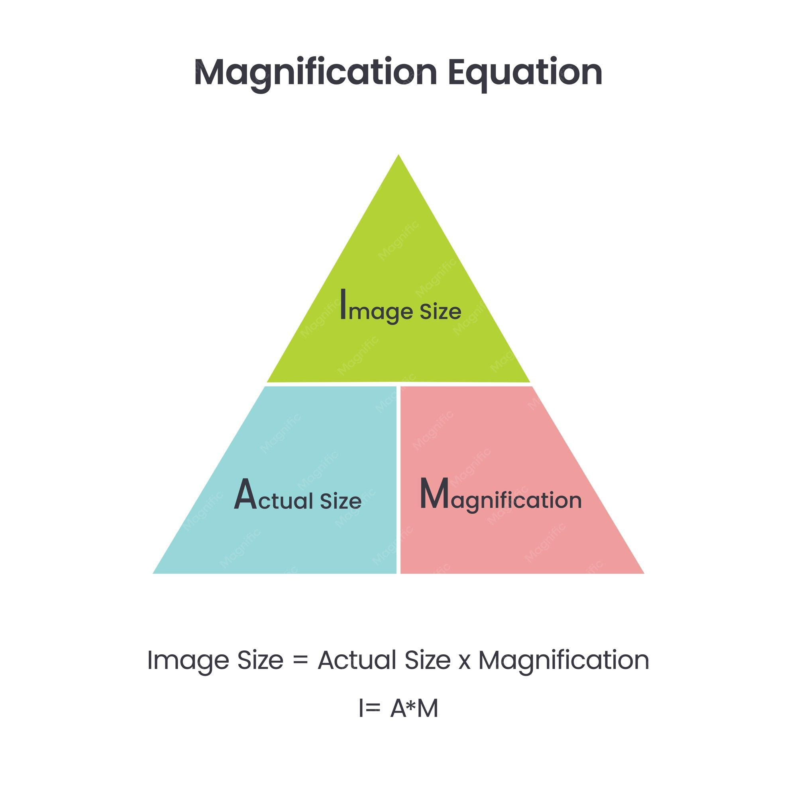
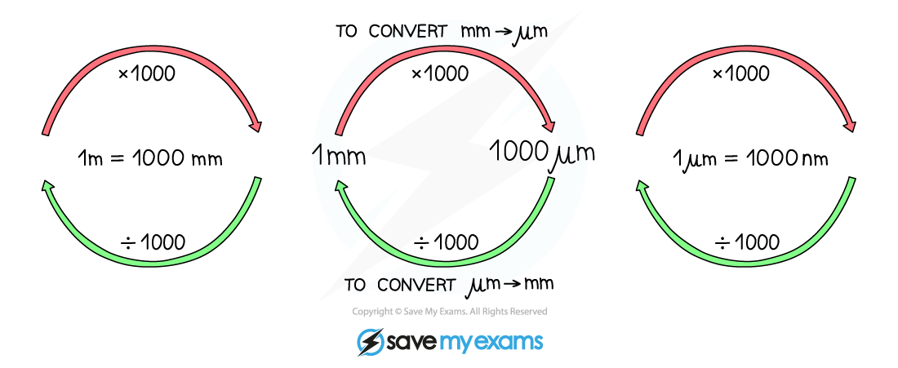

## Magnification

### Magnification is a calculation of how much something (for example, a cell) is enlarged. Magnification has no units! Just add an “x” before the value like this: x5 or x100.

### Ensure you use the same units when calculating magnification.

