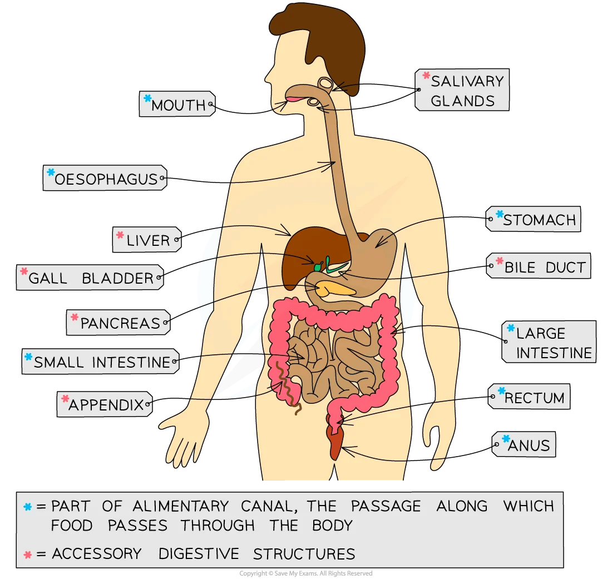

## The digestive system

#|
||

Structure

|

Function

||
||

Mouth/Salivary glands

|

* Mechanical digestion: teeth break down food into smaller pieces and increase its surface area.

* Chemical digestion: amylase enzymes in saliva start digesting starch into maltose

* The food is shaped into a bolus (ball) and mixed with saliva so it can be swallowed easily

||
||

Oesophagus

|

The tube that connects the mouth to the stomach

The walls of the oesophagus contract and relax to push the food towards the stomach. This is called peristalsis.

||
||

Stomach

|

* Food is mechanically digested by churning actions while protease enzymes start to chemically digest proteins.

* Hydrochloric acid is present to kill bacteria in food and provide the optimum pH for protease enzymes to work.

||
||

Small intestine

|

* The first section is called the duodenum; this is where digestion of the food exiting the stomach is completed by enzymes that are secreted by the pancreas

* The pH of the small intestine is slightly alkaline; around pH 8-9.

* The second section is called the ileum and is where the absorption of water and digested food molecules takes place; the ileum is long and lined with villi to increase the surface area over which absorption can take place

||
||

Large intestine

|

The site of water absorption and faeces is made from the waste products of food

||
||

Pancreas

|

* Produces all three types of digestive enzymes: amylase, protease and lipase

* Secretes enzymes in an alkaline fluid into the duodenum for digestion; this raises the pH of fluid coming out of the stomach

||
||

Liver

|

* Amino acids that are not used to make proteins are broken down here (deamination), producing urea

* Produces bile to emulsify fats (break large droplets into smaller droplets), an example of mechanical digestion

||
||

Gall bladder

|

Stores bile to release into the duodenum

||
|#

## Chemical and mechanical digestion

1. ### mechanical digestion: increases the surface area of food without chemically changing it; this aids the enzymes during chemical digestion.

2. ### chemical digestion: the breakdown of large insoluble molecules into small soluble molecules

   #|
   ||
   
   enzyme

   |
   
   substrate

   |
   
   product

   |
   
   where it functions

   ||
   ||
   
   amylase

   |
   
   starch

   |
   
   glucose

   |
   
   mouth

   ||
   ||
   
   protease

   |
   
   proteins

   |
   
   amino acid

   |
   
   stomach

   ||
   ||
   
   lipase

   |
   
   fats

   |
   
   fatty acids and glycerol

   |
   
   small intestine

   ||
   |#
   

### In summary, there are five major stages to the process of digestion, and they are:

1. ### Ingestion: the taking of substances into the body

2. ### Digestion: the breakdown of food, weather being chemically or mechanically.

3. ### Absorption: the movement of nutrients from the intestines into the blood.

4. ### Assimilation: uptake and use of nutrients by cells

5. ### Egestion: the removal of undigested food from the body as faeces.