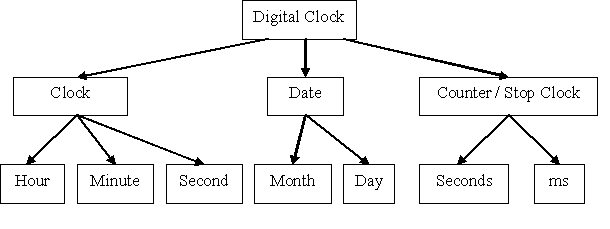

## Structure Diagrams

* Every computer system is made up of sub-systems, which are in turn
  made up of further sub-systems.

* **Structure Diagrams** – Structure diagrams can be created **top‑down**, where main tasks are split into smaller functions, or **bottom‑up**, where small functions are combined into larger tasks.

  A structure diagram shows this breakdown step by step, until each sub‑system performs only a single action. It is a diagrammatic representation of system design..

  