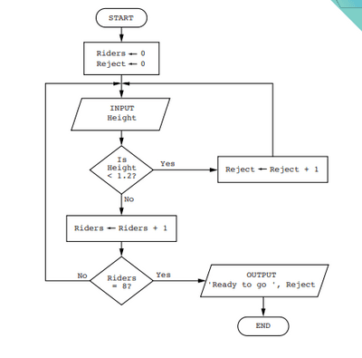
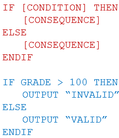
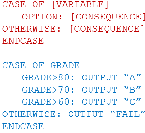
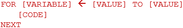
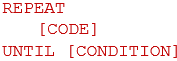
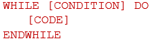
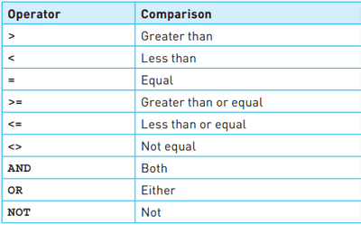

## Pseudocode & Flowcharts

* **Pseudocode -** Verbal representation of an algorithm (a process or
  set of steps) and flowcharts are a diagrammatic representation.

* **Flowcharts:** A flowchart shows diagrammatically the steps required to complete a task and the order that they are to be performed

* **Algorithm:** These steps, together with the order, are called an algorithm

  

An example of a flowchart is given below from a past paper question in which all of the functions of a flowchart are shown:



This flowchart’s task is to check if a rider’s height is more the requirement (1.2) in this case. It then counts until the accepted riders are 8. After they are 8, it outputs the number of rejected riders and tells the rest that they are ready to go!

## Pseudocode

* Declaration & Usage of Variables & Constants

  * Variable – Store of data which changes during execution of the program (due to user input)
  * Constant – Store of data that remains the same during the execution of the program

* Basic Data Types

  * Integer – Whole Number e.g. 2; 8; 100

  * Real – Decimal Number e.g. 7.00; 5.64

  * Char – Single Character e.g. ‘a’; ‘Y’

  * String – Multiple Characters (Text) e.g. “ZNotes”; “COOL”

  * Boolean – Only 2 Values e.g. True/False; Yes/No; 0/1

* **Input & Output (READ & PRINT) –** Used to receive and display data to the user respectively. *(It is recommended to use input and output commands)*

```
INPUT Name
OUTPUT "Hello Mr." , Name

// Alternatively //

READ Name
PRINT "Hello Mr," , Name
```

* **Declaration of variable -** A variable/constant can be declared by the following manner

```
DECLARE [Variable Name] : [DATATYPE OF VARIABLE]
```

* **Array:** Array is similar to variable but it can store multiple values of same datatype under single name

```javascript
DECLARE [ARRAYNAME] : ARRAY [Lower Limit : Upper Limit ] OF [DATATYPE]
```

* **Assignment -** Each variable is assigned using a left arrow.

```javascript
[VARIABLE NAME] <---- [Value to be assigned]
ArrayName [IndexValue] <---- [Value to be assigned]
```

* Conditional Statements:

  IF…THEN…ELSE…ENDIF

CASE…OF…OTHERWISE…ENDCASE – Multiple conditions and corresponding   consequences \\n  

* **Loop Structures:**

  ```
    FOR…TO…NEXT :  Will run for a determined/known amount of times  
  ```

  \
  \
  

  REPEAT… UNTIL – Will run at least once till condition is satisfied; Verification is done after running code                 WHILE…DO…ENDWHILE – May not ever run; Verification is done before running code               **Note:** When using conditions in these loop structures and conditional statement, it has to be kept in mind that it can be done in two ways.

  1. use of a Boolean variable that can have the value TRUE or FALSE
  2. comparisons made by using coparison operators, where comparisons are made from left to right

```
IF [BOOLEAN VARIABLE]
  THEN
    OUTCOME
  ELSE
    OUTCOME
 ENDIF      
```

```javascript
IF ((CONDITION 1) OR ( CONDITION 2)) AND (CONDITION 3) AND (CONDITION 4)
 THEN
  OUTCOME
 ELSE
  OUTCOME
ENDIF
```

## 

## Standard methods used in algorithm:

* Totalling :Totalling means keeping a total that values are added to

```javascript
Total ← 0
FOR Counter ← 1 TO LoopLimit
 Total ← Total + ValueToBeTotalled
NEXT Counter
```

* Counting: Keeping a count of the number of times an action is performed is another standard method.

```javascript
PassCount ← 0
FOR Counter ← 1 TO LoopLimit
 INPUT Value
 IF Value > Range
  THEN
    PassCount ← PassCount + 1
 ENDIF
NEXT Counter
```

* Maximum, minimum and average : Finding the largest and smallest values in a list are two standard methods that are frequently found in algorithms

```javascript
MaxiumumValue <--- Array[1] MinimumValue <--- Array[1]
FOR Counter ← 2 TO LoopLimit
 IF Array[Counter] > MaximumValue
  THEN
   MaximumValue ← Array[Counter]
 ENDIF

 IF Array[Counter] < MinimumValue
  THEN
   MinimumValue ← Array[Counter]
 ENDIF
NEXT Counter

// Average//

Total ← 0
FOR Counter ← 1 TO NumberOfValues
 Total ← Total + StudentMark[Counter]
NEXT Counter
Average ← Total / NumberOfValues
```

* **Linear Search:**  In a linear search, each item in the list is inspected sequentially until a match is found or the entire list is traversed.

```javascript

INPUT Value
Found ← FALSE
Counter ← 0
REPEAT
 IF Value = Array[Counter]
 THEN
  Found ← TRUE
 ELSE
  Counter ← Counter + 1
 ENDIF
UNTIL Found OR Counter > NumberOfValues
IF Found
 THEN
  OUTPUT Value , " found at position " , Counter, " in the list."
 ELSE
  OUTPUT Value , " not found."
ENDIF
```

* **Bubble Sort:**  Iteratively compare and swap adjacent elements in a list to sort them. Start from the first element and continue until the second-to-last element. After each pass, the last element is in its correct place. However, other elements may still be unsorted. Repeat the process, excluding the last element, until only one element remains or no swaps are needed.

```javascript
First ← 1
Last ← 10
REPEAT
 Swap ← FALSE
 FOR Index ← First TO Last - 1
  IF Array[Index] > Array[Index + 1]
   THEN
    Temp ← Array[Index]
    Array[Index] ← Array[Index + 1]
    Array[Index + 1] ← Temp
    Swap ← TRUE
  ENDIF
 NEXT Index
 Last ← Last - 1
UNTIL (NOT Swap) OR Last = 1
```