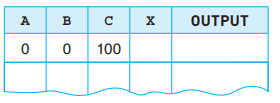

# Trace Table

* A trace table is utilized to document the outcomes of every step in an algorithm. It is employed to record the variable's value each time it undergoes a change.
* A **dry run** refers to the manual process of systematically executing an algorithm by following each step in sequence.
* A trace table is set up with a column for each variable and a column for any output e.g.

 

Test data is employed to execute a dry run of the flowchart and document the outcomes in a trace table. During the dry run:

* Whenever a variable's value changes, the new value is recorded in the respective column of the trace table.
* Each time a value is outputted, it is displayed in the output column.

An example of trace table is given below using a past paper question:

Q: The flowchart below inputs the height of children who want to ride on a rollercoaster. Children under 1.2 metres are rejected. The ride starts when eight children have been accepted.

 

Complete the trace table for the input data:
1\.4, 1.3, 1.1, 1.3, 1.0, 1.5, 1.2, 1.3, 1.4, 1.3, 0.9, 1.5, 1.6, 1.0

| Riders | Reject  | Height | OUTPUT |
|----|----|----|----|
| 0 | 0 |    |    |
| 1 |    | 1.4 |    |
| 2 |    | 1.3 |    |
|    | 1 | 1.1 |    |
| 3 |    | 1.3 |    |
|    | 2 | 1.0 |    |
| 4 |    | 1.5 |    |
|    | 3 | 1.2 |    |
| 5 |    | 1.3 |    |
| 6 |    | 1.4 |    |
| 7 |    | 1.3 |    |
|    | 4 | 0.9 |    |
| 8 |    | 1.5 | Ready to go 4 |

## Identifying errors:

* Trace tables can be used to trace errors in a program. For example, if the requirement for the previous question would be to accept riders that are of height 1.2 too, rather than rejecting them, then the error would have been caught in the trace table as when 1.2 is entered, it would increment rejected which it shouldn’t in our example

