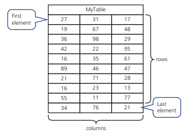

## Arrays

* An array is a data structure containing several elements of the same data type; these elements can be accessed using the same identifier name.
* The position of each element in an array is identified using the array’s index.
* There are two types of arrays

### **One-Dimensional Array**

*Explained in the previous chapter in detail*

### **Two-Dimensional Array**

* A two-dimensional array can be referred to as a table with rows and columns.
* When a two-dimensional array is declared in pseudocode, the first and last index values for rows and the first and last index values for columns alongside the data type are included.

**Declaring a 2D Array:**

```
DECLARE Name : ARRAY[RowLower:RowUpper,ColumnLower:ColumnUpper] OF DATATYPE
```

**Filling a 2-D array using a loop:**

```javascript
FOR ColumnCounter ← 1 TO 3
 FOR RowCounter ← 1 TO 10
 OUTPUT "Enter next value "
 INPUT ArrayName [RowCounter, ColumnCounter]
 NEXT RowCounter
NEXT ColumnCounter
```