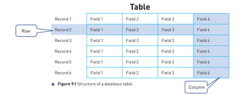

# Databases

A database is a well-organized compilation of data that enables individuals to retrieve information according to their specific requirements. The data contained within a database can encompass various forms such as text, numerical values, images, or any other type of digital content that can be stored on a computer system.

## Why do we need a database?

* To store data about people, things, and events.
* Any modifications or additions need to be made only once, ensuring data consistency.
* All users access and utilize the same set of data, promoting uniformity.
* Relational databases store data in a non-repetitive manner, eliminating duplication.

## What makes a database?

* Data is stored in **tables** in databases. Each table consists of a specific type of data e.g. cars. These tables HAVE to be named according to what they contain e.g. a table containing patient information will be ***PATIENT***
* These tables consist of **records** (rows). Each record consists of data about a single entity (a single item, person or event ) e.g. a single car
* These tables also have columns that are knows an **fields**. These consist of specific information regarding the entities that are written later in records e.g. car name, car manufacturer etc.

**Note: In this chapter, skills of dealing with a database are also required so working with Microsoft Access is needed to understand this chapter better.** You have to be able to define a single-table database from given data storage requirements, choose a suitable primary key for a database table and also be able to read, complete and understand SQL scripts.

 

Source: Cambridge IGCSE and O Level Computer Science by Hodder Education

## Validation in databases

* Database management software automatically provides some validation checks, while others need to be set up by the developer during construction.
* For example; The software automatically validates fields like "DateOfAdmission" in the ***PATIENT*** table to ensure data input is a valid date. \n 

