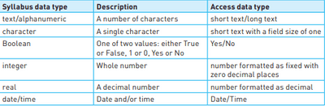

## Basic Data Types

Each field will require a data type to be selected. A data type classifies how the data is stored, displayed and the operations that can be performed on the stored value.

The datatypes for database are quite similar to original datatypes, however, there are a few differences.

 

*__Note: Access datatype refers to the software Microsoft Access which is a DBMS (DataBase Management System). Here, databases could be worked upon in practical form__*