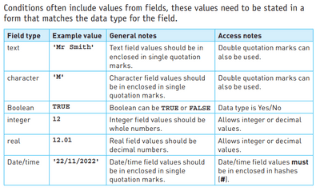
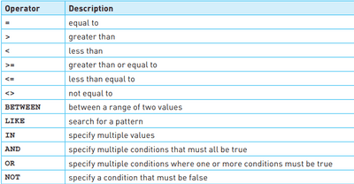

## Structured Query Language - SQL

* Structured Query Language (SQL) is the standard language for writing scripts to retrieve valuable information from databases.
* By using SQL, we can learn how to retrieve and display specific information needed from a database.
* For instance, someone visiting a patient may only require the ward number and bed number to locate them in the hospital, while a consultant may need a list of the names of all the patients under their care. This can be done using SQL

### SQL Scripts

* An SQL script is a collection of SQL commands that are used to perform a specific task, often stored in a file for reusability.
* To comprehend SQL and interpret the output of an SQL script, practical experience in writing SQL scripts is necessary.

**Select Statements:**

```javascript
SELECT (fieldsname)
FROM (tablesname)
WHERE (condition)
ORDER BY (sortingcondition) ;
```

**Selecting Sum of values in a table:**

```javascript
SELECT SUM ( fieldsname )
FROM (tablesname)
WHERE (condition)
ORDER BY (sortingcondition) ;
```

**Counting the number of records where the field matches a specified condition**

```javascript
SELECT COUNT ( fieldsname )
FROM (tablesname)
WHERE (condition)
ORDER BY (sortingcondition) ;
```

*==ORDER BY ASCENDING - sorts in ascending order.==*

*==ORDER BY DESENDING - sorts in descending order.==*

*Note: ORDER BY…is not necessary to add. It has to be only added if required!*



## Operators

Just like pseudocode, the operators used there can also be used here for conditions, however, a few more are also used in databases

