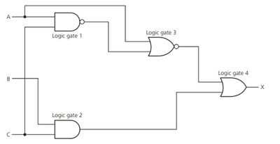

# Writing Logic Statements

Logic Statements is a way of showing all the logics that are in place for a logic circuit.

## Writing from a logic circuit

1. Look at the ciruit and go around the logic gates used in the circuit
2. Go from the one output that is being given towards the input
3. Write the last gate ( the first gate you walk through ) in the middle and then, for each of the value coming into the gate, leave space at the side
4. If the value coming into the gate is coming from another gate, use a bracket for the gate’s logic
5. Repeat process 3-4 till you are able to reach the input values fully

## Writing from a truth table

1. Create logic circuit fom the truth table (shown later)
2. Write the logic statement using the ciruit

## Writing from a Problem statement

1. See what logics go in place in the statement to take place
2. Go from the logic of any 2 inputs at the start, and then keep on going until you are able to reach the final gate which gives the output
3. When writing the statement, make sure you show the logic statement where the output is 1

## Example of a LOGIC STATEMENT

**(B AND C) OR (A NOR (A NAND C))** is the logic statement for the following Logic Circuit

 