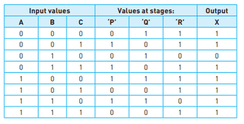

# Creating Truth Tables

## From Logic Circuits

1. Create a truth table with each input possible, creating every possible combination of inputs . **Tip: For the first input, write it in the combination of 1,0,1,0 and so on. For the second, go 1,1,0,0 and so on, and for the third one, go 1,1,1,1,0,0,0,0 going by the powers of 2 for each input. This would guarantee each possible combination**
2. Run through the circuit with the inputs and get the output that will be reached and write it accordingly

### For logic statements, and problem statements, convert them to logic circuits first and then do the rest

## Example

This is the example of a truth table of a logic circuit

 The circuit: 

 