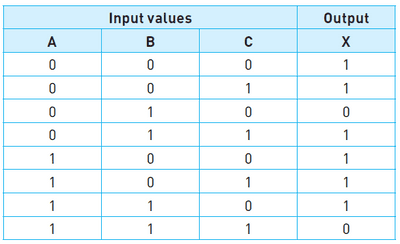

# Logic Statements from Truth Tables

 

1. Given the truth table above, take the rows where the output (x) is 1 (Rows 1, 2, 4, 5, 6, 7)
2. Create a logic expression from these rows (example, row 1 will be (NOT A AND NOT B AND NOT C) = X
3. Create logic expressions for all the rows with output 1 and connect them with OR gate

