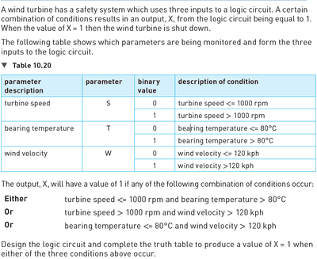

# Exam-Style Question

 

1. The Conditions are given so make logic statements using the conditions and the table. (NOT S AND T) OR (S AND W) OR (NOT T AND W)
2. Make the logic circuit from the given equation
3. Make the truth table

