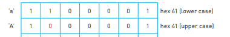

## Text, Sound and Images

### **ASCII**

* The standard ASCII code character set consists of 7-bit code that represents the letters, numbers and characters found on a standard keyboard, together with 32 control codes
* Uppercase and lowercase characters have different ASCII values
* Every subsequent value in ASCII is the previous value + 1. e.g.  “a” is 97 in ASCII, “b” will be 98 (which is 97 + 1)
* Important ASCII values (in denary) to remember are as follows:
- [ ] 0 is at 48
- [ ] A is at 65
- [ ] a is at 97
* ASCII uses one byte to store the value
* When the ASCII value of a character is converted to binary, it can be seen that the sixth-bit changes from 1 to 0 when going from lowercase to uppercase of a character, and the rest remains the same. e.g.

  

### **Unicode**

* ASCII does not contain all of the international languages thus, Unicode is used to solve this problem
* The first 128 values are the same as ASCII.
* Unicode supports up to four bytes per character, storing multiple languages and more data.
* **To represent text in binary, a computer uses a character set, a collection of characters and the corresponding binary codes that represent them.**

### **Sound**

* Sound is analogue, and for it to be converted to digital form, it is sampled
* The sound waves are sampled at regular time intervals where the amplitude is measured. However, it cannot be measured precisely, so approximate values are stored

### **How is Sound Recorded**

* The amplitude of the sound wave is first determined at set time intervals
* The value is converted to digital form
* Each sample of the sound wave is then encoded as a series of binary digits
* A series of readings gives an approximate representation of the sound wave

### **Sampling Resolution:**

* The number of bits per sample is known as the sampling resolution (aka bit depth)
* Increasing the sampling resolution increases the accuracy of the sampled sound as more detail is stored about the amplitude of the sound.
* Increasing the sampling resolution also increases the file size of the file as more bits are being used to store the data.

### **Sampling Rate**

* The sampling rate is the number of sound samples taken per second, which is measured in Hertz (Hz)
* A higher sampling rate would allow more accurate sound as fewer estimations will be done between samples.

### **Images**

### **Bitmap/ Raster Images**

* Bitmap images are made up of pixels
* A bitmap image is stored in a computer as a series of binary numbers

### **Colour Depth**

* The number of bits representing each colour is called the colour depth.
* An 8-bit colour depth means that each pixel can be one of 256 colours (because 2 to the power of 8 = 256)
* A 1-bit colour depth means each pixel can store one colour (because 2 to the power of 1 is 2) - ( This is done as the bit can either be 0 or 1, with 0 being white and 1 being black)
* Increasing colour depth increases the size of the file when storing an image.
* True colous uses 24 buts, one byte per colour (Red, Green, Blue), and 32 bit colour can be used for professional Printing (with one byte for CMYK - Cyan, Magenta, Yellow and Black) or alternatively RGB with one channel for transparency (called the Alpha Channel)

### **Image Resolution**

* Image resolution refers to the number of pixels that make up an image; for example, an image could contain 4096 × 3072 pixels.
* Photographs with a lower resolution have less detail than those with a higher resolution.
* When a bitmap image is ‘ blurry ‘ or ‘ fizzy ’ due to having a low amount of pixels in it or when zoomed, it is known as being **pixelated.**
* High-resolution images use high amounts of memory as compared to low-resolution ones.