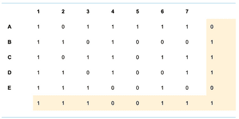

## Methods of Error Detection

### **Parity Checks**

* It uses the number of 1-bits in a byte
* Two Types -
  * Even - Even number of 1-bits
  * Odd - Odd numbers of 1-bits
* Example (Even Parity) -

|0|**1**|**0**|**1**|**1**|**0**|**1**|**0**|
|:---|:---|:---|:---|:---|:---|:---|:---|
|||||||||

* The **LMB (Left-Most Bit)** is the parity bit. As the number of 1s is even, the parity bit would be set to even.

  
<b>Limitations with Parity Checks</b>

* Two bits may change during transmission; therefore error is not found

* Even though the parity checks would reveal the errors, the bit(s) changed wouldn’t be identified

### **Parity Blocks**

* To overcome the limitations of parity bits, Parity blocks would be used.  
* Any changes in bits would be identified through the rows and columns

### **Checksum**

* Whenever a block of data needs to be sent, the sender would calculate the checksum value using a specific algorithm.
* Once the data has been sent, The receiver would calculate the checksum again with the same set of data and the same algorithm used before.
* The receiver would then compare the value received and the newly calculated value. If they aren’t matched, A request is made to re-send the data.

### **Echo Check**

* Once the data has been sent, The receiver will send the data back to the sender for verification.
* The sender would compare the received and original data for errors.
* Downsides:
  * We wouldn’t know if the error occurred when sending the data or sending the data back for verification.

  * It is bandwidth intensive as all data has to be sent twice. 

### **Check Digits**

* Check digits are calculated from all the other digits in the data (ex-codes). The check digit would be the last digit of the code.
* These are used to identify mistyping errors such as -
  * 6372 typed as 6379
  * 8432 typed as 842

### **Automatic Repeat Requests (ARQs)**

* Uses acknowledgements and timeouts to make sure the user received the data
* The receiver would check the data for any errors; if none are found, a positive acknowledgement is sent to the sender. However, if errors are found, a negative acknowledgement will be sent, and the data will be sent again.
* The sender uses timeouts to wait for a pre-determined amount for the acknowledgement.
* If no acknowledgements are received after the timeout, the data will be sent again to the receiver.