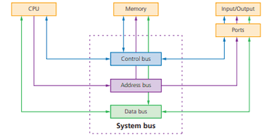

# Hardware

## Computer Architecture & Von Neumann Architecture

* The central processing unit (CPU) (also known as a microprocessor or processor) is central to all modern computer systems

**The CPU consists of the following architecture:**

* **Processor:** The processor contains the Arithmetic and Logic Unit (ALU)
* **Control Unit:** The control unit controls the operation of the memory, processor and                            input/output devices
* **Arithmetic Logic Unit:** carries out mathematical functions (Arithmetic) and comparisons (Logic)
* **System Clock:** The system clock is used to produce timing signals on the control bus
* **Registers:** small, quick memory that temporarily hold tiny amounts of data and instructions needed for processing.

**System Buses:** Carry data through components. The following are its types.

* *Address bus* – unidirectional
* *Data Bus* – bi-directional
* *Control Bus*  – bi-directional

**Immediate Access Store:** Stores the instructions that are to be processed, which are fetched by the CPU

* **The following registers also exist in the architecture:**

|ABBREVIATION|REGISTER|FUNCTION|
|:---|:---|:---|
|CIR|Current instruction register|Stores the instruction the CPU is currently decoding or executing|
|MAR|Memory address register|Stores the Address of the instruction, copy it, and sends it to MDR|
|MDR|Memory data register|Stores the Data from the address received from the MAR and sends data to CIR|
|PC|Program counter|Stores the address of the next instruction to be fetched from memory|
|ACC|Accumulator|During calculations, data is temporarily held in it|

### **The Fetch-Execute Cycle**

1. PC contains the address of the next instruction to be fetched
2. This address is copied to the MAR via the address bus
3. The instruction is fetched from the main memory (RAM) via the data bus.
4. The instruction of the address is copied into the MDR temporarily
5. The instruction in the MDR is then placed in the CIR
6. The value in the PC is incremented by 1, pointing to the next instruction to be fetched
7. The instruction is finally decoded and then executed

### **Stored Program Concept**

* Instructions are stored in the main memory
* Instructions are fetched, decoded, and executed by the processor
* Programs can be moved to and from the main memory

### **Memory Concept**

* A computer’s memory is divided into partitions: Each partition consists of an address and its contents, e.g.

|MEMORY LOCATION|CONTENT|
|:---|:---|
|10101010|01010110|

**Instruction Set:**

An instruction set is a list of all the commands that a CPU can process, and the commands are machine code