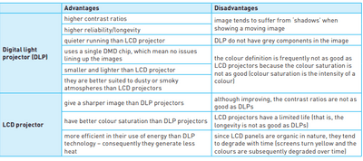

## Output Devices

**Inkjet Printers**

* Used to print one-off pictures and documents
* Data from the document sent to the printer driver
* The printer driver ensures data is in the correct format
* Check made by printer driver that the chosen printer is available
* Data is sent to the printer and stored in a temporary memory (printer buffer)
* A sheet of paper is fed; the sensor detects if the paper is available in the paper tray
* The print head moves across paper printing text/image, four ink colours sprayed in the exact amount
* Paper is advanced, so the next line is printed
* Repeated until the buffer is empty
* Once it is done, the printer sends an interrupt to the processor (request for more data to be sent)

**Laser Printers**

* Used to print flyers, high quality
* Use dry powder ink (toner) and static electricity to produce text
  and images
* Prints the whole page in one go

<!-- end list -->

1. (steps 1-4 same as inkjet)
2. The printing drum is given a positive charge; as the drum rotates, a laser beam is scanned across it; removing the positive charge leaves negatively charged areas which match the text/image
3. The drum is then coated with positively charged *toner; it* only sticks to negatively charged parts of the drum
4. A negatively charged sheet is rolled over the drum
5. The toner on the drum now sticks to the paper to produce a copy of the page
6. Paper finally goes through a fuser (set of heated rollers); heat
   melts the ink so it is permanent
7. The discharge lamp removes all electric charge from the drum, ready to print on the next page

**3D Printers**

* Used for models of cars
* Produce solid objects that work
* Built up layer by layer, using powdered resin, ceramic powder
* A design is made using Computer-aided Design (CAD)

**2D and 3D Cutters**

* 3D cutters can recognise objects in x, y, z direction
* 3D laser cutters can cut glass, crystal, metal, wood

**Actuators**

* The actuators convert electrical signals to mechanical processes.
* Used in many control applications involving sensors and devices (ADC and DAC)

**Loudspeakers/Headphones**

* Sound is produced by passing the digital data through a DAC, then through an amplifier, and then emerges from the loudspeaker
* Produced by voltage differences vibrating a cone in the speaker at
  different frequencies

**LCD and LED Monitors**

* The front layer of the monitor is made up of *Liquid Crystal Display* (LCD); these tiny diodes are grouped in threes as pixels (LCD doesn’t emit any light)
* LCD monitors are backlit using *Light Emitting Diode (LED)*
  because:
  * LEDs reach their maximum brightness immediately
  * LEDs sharpen image (higher resolution), and CCFL has a yellow tint
  * LEDs improve the colour image
  * Monitors using LED are much thinner than CCFL
  * LEDs consume very little power
* Before LEDs, LCD monitors were backlit using CCFL
* CCFL uses two fluorescent tubes behind the LCD screen, which supplies the light source

**Light Projectors:**

* Two common types of light projectors:
  * Digital Light Projector (DLP)
  * LCD Projector
* Projectors are used to project computer output onto larger
  screens/interactive whiteboards

**Digital Light Projectors (DLP)**

* Uses millions of micromirrors
* the number of micromirrors and the way they are arranged on the DLP chip determines the resolution of the image
* When the micromirrors tilt towards the light source they are *on*
* When the micromirrors tilt away from the light source, they are *off*
* This creates a light or dark pixel on the projection screen
* A bright white light source passes through a colour filter on its way to the DLP chip
* White light splits into primary colours

**LCD Projectors**

* Older technology than DLP
* A powerful beam of white light is generated from a bulb
* This beam of light is then sent to a group of chromatic-coated mirrors; these reflect the light at different wavelengths
* When the white light hits the mirrors, the reflected light has wavelengths corresponding to red, green, and blue
* These three different lights pass through three LCD screens; these screens show the image to be projected as millions of pixels in grayscale
* When the coloured light passes through the LCD screens, a red, green and blue version of the grey image emerges
* Finally, the image passes through the projector lens onto the screen

 

`Source: Cambridge IGCSE and O Level Computer Science - Second Edition (Hodder Education)`