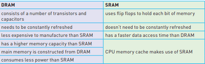

## Memory, Storage Devices & Media

Primary vs. Secondary Storage

* The CPU directly accesses primary storage
* RAM, ROM, and cache memory are some examples of primary storage
* The CPU does not directly access secondary storage
* HDD, SSD, DVD, memory stick, and Blu-ray disc are some examples of secondary storage

**Primary Memory:**

**Random Access Memory (RAM)**

* RAM is used by a system when it needs to store and access data that is actively being used or processed by the user immediately.
* Features of RAM
  * Volatile/temporary memory (contents lost if RAM is turned off)
  * Used to store; data, files
  * It can be written to or read from, and the contents of the memory can be changed
* The larger the size of the RAM, the faster the computer will operate
* RAM never runs out of memory and continues to run slow
* As RAM becomes full, the processor has to access the continually hard drive to overwrite old data on RAM with new data
* RAM is of two types:

DRAM (Dynamic RAM) and SRAM (Static RAM)

`Source: Cambridge IGCSE and O Level Computer Science - Second Edition (Hodder Education)`

Virtual memory

* When RAM runs out of memory, there is a problem with memory management; thus, the system has a high chance of crashing. This is why virtual memory comes into the picture.
* The virtual memory can be either HDD or SSD (these storages are discussed below)

* You may be expected to draw a diagram like the above.
* The main advantages of virtual memory are
  * They can be larger than the physical memory provided in the RAM.
  * Avoids the need to install/upgrade RAM, as it could be expensive
  * The system wastes no storage on unwanted/unused data.

**Read Only Memory (ROM)**

* Features of ROM
  * Non-volatile/permanent memories (contents remain even when ROM
    is turned off)
  * Used to store start-up instructions (basic input/output systems)
  * Data/Contents of a ROM could not be changed and is read-only, modern devices vastly use re-programmable non-volatile memory, like EEPROM or Flash, for firmware such as the BIOS to allow for necessary upgrades.

**Secondary Storage:**

**Hard Disk Drives (HDD)**

* Data is stored in a digital format on the magnetic surface of the
  disks (platter)
* A number of read/write heads can access all of the surfaces of the disk
* Each platter will have two surfaces which can be used to store the
  data
* Data is stored on the surfaces in sectors and tracks
* HDD has very slow data access compared to RAM

**Solid-State Drive (SSD)**

* There are no moving parts, and all data is received at the same time (not like HDD)
* Store data by controlling the movement of electrons within NAND
  chips, as 1s and 0s
* Non-volatile rewritable memory
* Benefits of using SSD rather than HDD:
  * More reliable (no moving parts)
  * Considerably lighter (suitable for laptops)
  * Lower power consumption
  * Run much cooler than HDDs
  * Very thin
  * Data access is faster than HDD
* Drawback – questionable longevity (20GB per day)

**Off-Line Storage:**

**CD/DVD Disks**

* Laser (red) light is used to read and write data on the surface of the disk.
* A thin layer of metal alloy is used to store data.
* Both systems use a single spiral track that runs from the centre of the disk to the edge
* DVD uses *Dual-Layering,* which increases the storage capacity (two individual recording layers)

**Blu-ray Disks**

* Uses a blue laser to carry out read-and-write operations
* The wavelength of laser light is less than CD and DVD (stores up to five times more data than DVD)
* Automatically come with secure encryption (prevent piracy and
  copyright infringement)
* Used as backup systems

**USB Flash Memories**

* Very small, lightweight, and suitable for transferring files
* Small back-up devices for photo, music
* Solid state, so needs to be treated with care

**Cloud Storage:**

* Cloud storage is a method of data storage where data is stored on remote servers
* The same data is stored on more than one server in case of maintenance or repair, allowing clients to access data at any time. This is known as **data redundancy.**

**The following are its types:**

* **Public cloud** – this is a storage environment where the customer/client and cloud storage provider are different companies
* **Private cloud** – this is storage provided by a dedicated environment behind a company firewall; customer/client and cloud storage provider are integrated and operate as a single entity
* **Hybrid cloud** – this is a combination of the two above environments; some data resides in the private cloud, and less sensitive/less commercial data can be accessed from a public cloud storage provider

