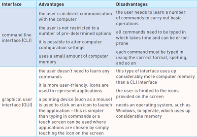
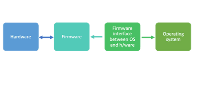

## Operating Systems

* Operating Systems are designed to establish communication between the user and the computer
* Functions of a typical operating system -

  \-managing files

  – handling interrupts

  – providing an interface

  – managing peripherals and drivers

  – managing memory

  – managing multitasking

  – providing a platform for running applications

  – providing system security

  – managing user accounts
* WIMP - Windows, Icons, Menu, and Pointing Devices

Advantages and Disadvantages of CLI and GUI

 Source: Cambridge IGCSE and O Level Computer Science - Second Edition (Hodder Education)

* Memory Management - Manages the RAM and the HDD/SSD during the execution of programs
* Security Management - Providing security features such as Anti-Virus, System updates and so on
* Hardware Peripheral Management - Managing the device drives, Inputs, Outputs, Queues and buffers
* File Management - Opening, Creating, Deleting, Renaming, and many more functions
* Multitasking - OS would share the hardware resources with each of the processes
* Management of User Accounts - OS would allow multiple users to customise their accounts individually.

### **Running of Applications**

* The computer starts its OS (booting up the computer) through the bootstrap loader.
* The BIOS (Basic Input/Output System) tells the computer the location of the OS in the storage.
* BIOS is often referred to as the firmware

   

### **Interrupts**

* Signal that causes the microprocessor to stop what it's doing and service the task
* Ensures important tasks are dealt with on a priority basis
* It can be a software or a hardware interrupt
* Peripherals like a keyboard & mouse can generate it
* Different interrupts have different levels of priority
* After interruption is dealt with, the previous process continues

