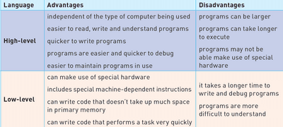

## Programming Languages, Translators and IDEs

* Computers can only understand **machine code;** therefore, translators are needed

**High-Level Languages**

* It is easier to read and understand as the language is closer to human language.
* Easier to write in a shorter time
* Easier to debug at the development stage
* Easier to maintain once in use

**Low-Level Languages**

* Refer to machine code
* Binary instructions that the computer understands

`Source: Cambridge IGCSE and O Level Computer Science - Second Edition (Hodder Education)`

**Assembly Language**

* Few programmers use assembly language to -
  * Make use of special hardware
  * Write code that doesn’t take up much space
  * Write code that runs very quickly
  * Assembly language must be translated into machine code using an assembler to run.

## Translators

**Compiler**

* Translates a program written in a high-level language into machine code
* Used without interpreter 
* Executable file of machine code produced
* One high-level language translated into several machine code instructions
* Used for general use

**Interpreter**

* Executes a high-language program a statement at a time
* No executable file of machine code produced
* One high-level language program statement may require several machine code instructions to be executed.
* Interpreted programs cannot be used without an interpreter
* Used when the program is being developed

**Assembler**

* Translates a low-level language program into machine code
* Executable file of machine code produced
* One low-level language translated into one machine code instructions
* It can be used without an assembler
* Used for general use

|Compiler|Interpreter|Assembler|
|:---|:---|:---|
|Translates a high-level language program into machine code.|Executes a high-level language program one statement at a time.|Translates a low-level assembly language program into machine code.|
|An executable file of machine code is produced.|No executable file of machine code is produced.|An executable file of machine code is produced.|
|One high-level language statement can be translated into several machine code instructions.|One high-level language program statement may require several machine code instructions to be executed.|One low-level language statement is usually translated into one machine code instruction.|
|Compiled programs are run without the compiler.|Interpreted programs cannot be run without the interpreter.|Assembled programs are used without the assembler.|
|A compiled program is usually distributed for general use.|An interpreter is often used when a program is being developed.|An assembled program is usually distributed for general use.|

`Source: Cambridge IGCSE and O Level Computer Science - Second Edition (Hodder Education)`

### **Integrated Development Environments (IDEs)**

* An IDE would usually have these features -
  * Code Editor
  * Translator
  * Debugger
  * Error Reports
  * Auto-Completion and Auto-Correction
  * Auto-Documenter
  * Pretty Printing