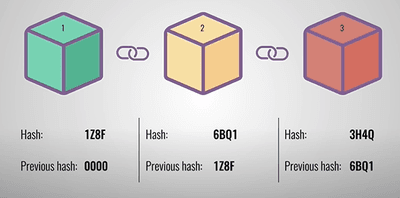

## Digital Currency

* Form of payment to pay for goods and services
* A few examples are Debit/Credit Cards, Apps (Paypal, Apple Pay, Bank Transfers and many more)
* Cryptocurrency was later introduced due to the problem in centralised banking systems.
* Cryptocurrency uses cryptography to maintain track of transactions.
* Cryptocurrency is also more secure because it uses **Blockchain Network**

### **Blockchain Network**

* Blockchain Network involves several interconnected computers where the transaction data is stored
* Hacking isn’t possible here as transaction details would be sent to all the computers, and the data can’t be changed without the consent of all the network members

### **How do blockchains work**

Every time a transaction takes place, A block is created. The block would contain -

* Data - Name of the sender and the receiver, amount of money and more
* Hash Value - Unique value generated by an algorithm
* Previous Hash Value - Hash Value of the previous block in the chain

The first block is called the genesis block as it doesn’t point to any previous block (Previous Hash Value - 0000)