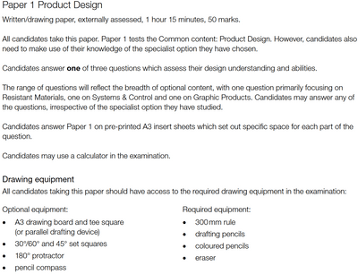

# Paper Overview

* Here is the official description that Cambridge offers:

 

### **Basic information for P1: Product Design**

* Total marks: 50
* Paper weightage: 25%
* Total time: 1 hour 15 minutes
* Recommended equipment:
  * 30 cm ruler (**this is a MUST**)
  * HB Pencil (normal pencil)
  * Colouring pencils
  * Rubber/Eraser
* 3 Questions (**only do 1**)

### **Question Information**

As mentioned above, you will be given **3 questions**, of which you are supposed to **do only 1.**

Each question will be on one of the following units:

* **Mechanical Unit**
  * You will be asked to draw a mechanism that is supposed to do a job (such as a system to release chickens).
* **Storage Unit**
  * A storage for a specific amount of equipment (dimensions and minimum quantity are given on the paper).
* **Advertisement Unit**
  * A stand or something that will attract customers (it is usually supposed to perform a particular function).

**It is HIGHLY recommended that you choose either the Advertisement or Storage unit!**

The Mechanical unit can be very complicated to draw and time-consuming.