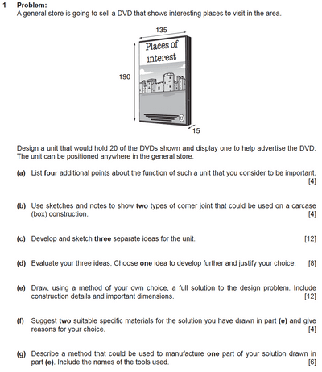

# Question Explanation

* The hardest part of the paper is managing your time and knowing how to answer each question concisely.
* Have a past paper open **before** **you go through** this card! (It will help you understand).

**The question structure does not change from paper to paper!**

* Here is a past paper question list:
* This is the **Specimen Paper 2020.**

 

| Question Number: | Tip 1: | Tip 2: |
|----|----|----|
| 1(a) | Some points are already stated in the question, so don’t repeat them; you won’t gain any marks. | This question must be done quickly to maximize the time available for the other, longer questions. |
| 1(b) | Annotations are helpful and can help explain your diagrams if you are not very good at drawing. | Don’t bother perfecting the pictures; make sure the drawing is worth 1 point and the idea is worth 1 point. Over-detailing wastes time. |
| 1(c) | It is recommended to draw either in a two 2-point perspective or an isometric (I prefer 2 points). | Annotations can help you gain extra marks where your drawing lacks a bit (try annotating some key points, aiming for 3-4 annotations). |
| 1(d) | Do not just describe the structure, but explain its positive and negative aspects (don’t say it has two handlebars; that is describing. It is better to mention it has 2 bars located at various heights to allow people of different heights to reach). | List both the positives and negatives of each of your drawings! Don’t make one perfect and the other(s) completely terrible. |
| 1(e) | Again, annotation and measurements are a must for this question! (You don’t have to draw to scale, but include the measurements). | Don’t bother shading if you don’t have enough time! I recommend shading only after you have completed all the questions so you don’t miss one because you don’t have enough time. |
| 1(f) | Specify the material; it has to be a subset of the material (simply saying metal is not good, you have to mention “corrugated steel”). | Be aware of the marks! It is one mark for each material and one mark for each explanation. |
| 1(g) | Specify the name of the tool that will be used. It is highly recommended drawing multiple perspectives of the manufacturing process, side profile, top view, etc. | Include dimensions and annotations. Be aware that brand names do not gain you any marks! |

* It is highly recommended that you practice the drawing questions inside out.

