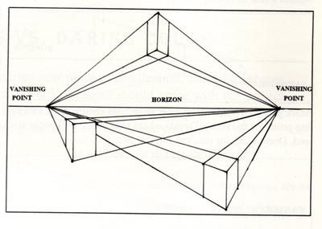

# Drawing Techniques

## 2 Point Perspective

* It is similar to what it sounds; the point is to draw 2 points on the paper connected with a straight line (known as the horizon).
* Then, by using vertical lines and joining them to the points, you can create 3D shapes. You can change the object's width by making the lines closer or farther from the points.

Here are some videos (I think it’s easier to see than to read about them):

* <https://www.youtube.com/watch?v=1Fcbk_K5qWA&t=340s> (video covers the complete basics)
* <https://www.youtube.com/watch?v=vyeZbyEvZ28> (sketch of a house with explanations)
* <https://www.youtube.com/watch?v=29-bPAhvzFI> (for squares, the most common shape used when drawing)

 