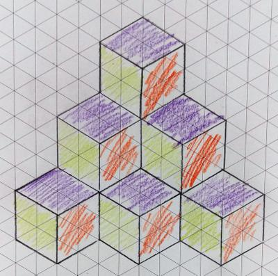

## Isometric Drawing

* Isometric is the method of drawing on 60-degree triangles.
* It is more complicated than a 2-point perspective, as you are not given the triangular paper in the exam!
* It is worth knowing both methods as examiners like to see variety (for the main project, like various sketches).

Here are some videos to see how to draw in isometric:

* <https://www.youtube.com/watch?v=o3kA8yAw9So> (no special paper used!)
* <https://www.youtube.com/watch?v=zWZtqzlFszQ> (super basic guide)
* <https://www.youtube.com/watch?v=LY5OqKhEP9k> (longer video)

  \
   
* In conclusion, it is highly recommend learning to draw in a 2-point perspective quickly and without mistakes; it can save you a lot of time compared to isometric!

