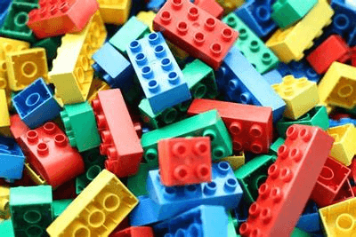
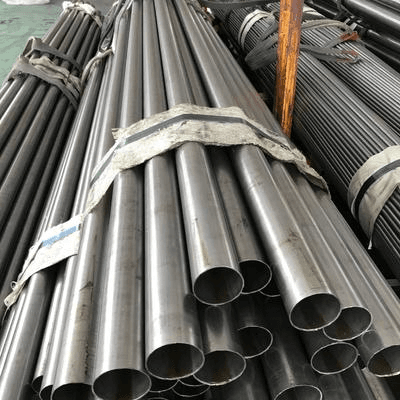

## Applications of Materials

* **Plastic** is a new material. However, it is one of the most common materials now. Anything (almost) can be made out of plastic; whether it’s toys, cars, prosthetic limbs or food containers, it is all plastic. Plastic is a higher fraction of all, and out of different fractions, multiple plastic products can be created. (More details on other cards)
  * An example of a toy (LEGO) made out of plastic is shown below. 
* **Wood** is very common; houses are constructed out of wood, and toys for children are constructed out of wood. An everyday use for wood is furniture (tables, chairs, stools). It is one of the earlier materials that was developed (used) by humans.
  * An example of a **wooden cabin** is shown below. 

* **Metal** is also very common; it is also used in housing, piping (copper) and furniture like tables, desks, and garden chairs. There are almost infinite uses for metal, and covering them all would require pages.
  * Here is an example of **metal pipes**, shown below. 

* These are the 3 essential materials that you should know: Plastics come up very often on exam papers!

