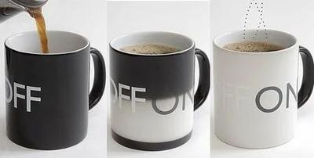
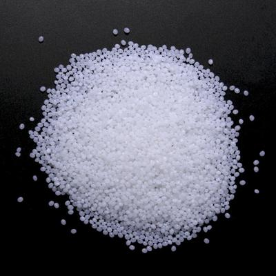
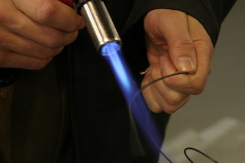
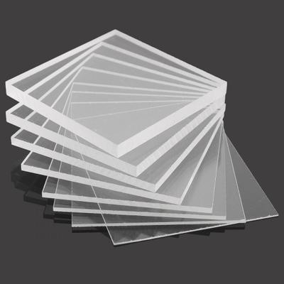

## SMART Materials

### **Introduction**

* Smart materials are **new** materials that are usually created for a specific function.
* These materials are usually more expensive and less frequently used than typical materials such as metals, plastics and wood.
* Examples of these materials include:
  * Shape Memory Alloy (SMA)
  * Acrylic
  * Polymorph
  * Thermochromic
* Note that there are many others. However, these are the **most common.**

### **Thermochromic**

* These materials experience colour changes depending on the temperature.
* Simply put, when heat strikes the material, the liquid crystals get closer together. How close the crystals produce a different colour (Based on some complicated chemistry)
* When it is colder, the crystals become further apart.
* Thermo means heat
* Chromic means colour
* **Uses:**
  * Smart Windows
  * Sensors
  * Printing Technologies

     
* An example of a Thermochromic mug in action is shown above.

### **Polymorph**

* Polymorph is a polymer that can be morphed at a very low temperature.
* It turns from opaque (non-see-through) to clear once heated.
* Biodegradable
* A benefit is that it can be reheated and reformed multiple times!
* Because of the size and low morphing point (temperature-wise), it can be morphed into places that would usually be considered very difficult.
* **Uses:**
  * Ergonomic Handles
  * Molds for Vacuum forming
  * Shoe/Sport components.

 

* An example of the **Polymorph pellets** is shown above.

### **Shape Memory Alloy (SMA)**

* Shape Memory Alloys are very complicated hence, we will only cover the basics.
* This material takes the shape of something when heated. **Under stress and pressure**, it takes the shape of the object you want it to be.
* It is a relatively **new material**, and its discovery was only in the **1930s.**
* It is an alloy, which means that it is made out of multiple materials (Iron (Fe) and zinc (Zn), are some common elements present in the alloy)
* Depending on the elements used, the **hardness can vary.**
* **Uses**:
  * Components in buildings and bridges can be out of SMA
  * Medicine, such as dentistry (A precise example would be dental braces)
  * Aircraft and Aviation Industry (Still mostly in development)

 

* Shape Memory Alloy wire **in preparation**, as shown above.

### **Shape Memory Polymer (Acrylic)**

* Acrylic is a **petroleum-based transparent** plastic material.
* It is **transparent and can be bent** easily through the process of melting. (Specifically, the process is called Thermoforming)
* It is particularly **resistant to weathering** (Hence why you see a lot of outdoor furniture used for it).
* There are many subcategories of this material however you are not supposed to know that for the IGCSE syllabus.
* **Uses**:
  * Indoor-outdoor furniture/equipment
  * Frames and Display cases
  * LED diffusing lighting panels

 

* An example of **clear acrylic boards** is shown above.

