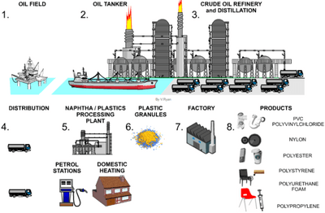
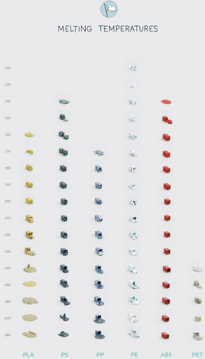

## Plastics Production Overview & Temperatures

### **From Oil to Products**

I think it is important to understand the brief production of Plastics. Most plastics undergo this way of production.

 

### **The Production Process**

1. Oil is extracted either from an offshore platform on an oil field.
2. The crude oil is then pumped from the platform to an oil tanker.
3. The tanker transports the oil to an oil refinery plant, where the crude oil is treated and separated into different fractions.
4. The oil is then distributed around different processing plants (depending on the fractions).
5. The oil is processed into small plastic granules at a Naphtha processing plant (higher fraction of oil).
6. These plastic granules are small and are of the desired colour.
7. The plastic granules are then sent to a Factory, melting and forming (via different methods) into the desired products.
8. A variety of products are made, and they are then sent to the stores or shipped to their customers.

### **Plastic Melting Temperatures**

* This is a small diagram to show the different melting points of plastics.
* Please note that the temperature is **lowest at the top** and **highest at the bottom.**

 

* Melting points of plastics are important because depending on that (and other factors) we can decide which one to use for a certain object.

