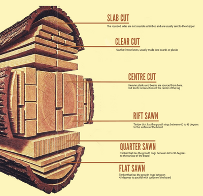

## Woods & Timbers

### **General Ideas**

* Wood is usually referred to as Timber, It has been used for a very **long time** and is one of the **most common** materials
* There are 2 types of woods; Softwoods and Hardwoods
* Softwoods come from **coniferous trees** (Don’t lose leaves in the winter)
* Hardwoods come from **deciduous trees** (Lose leaves in the winter)
* The strength of the wood is decided by how close the grain is together (the circles that you can see to see how old a tree is..)
  * The closer the grain, the stronger the wood
  * Because hardwoods grow slower, their grain is closer together so they have higher strength
  * The slow growth also means that they are usually **more expensive**
  * Woods with a grain closer together are **denser**
* Depending on how you take apart a tree can vary its properties.

 

### **Softwood Timber**

These are the main types of Softwood:

| Name of Timber | Description | Uses |
|----|----|----|
| Scots Pine | **Straight-grained** but contains **many knots, Pale in** colour, **Considerably strong** yet **simple to work with, Cheap** and **commonly available** in stores | Low-cost furniture, Construction work, Simple joinery |
| Parana Pine | **Hard** and **Straight grained, Rarely contains** knots, Relatively strong, **Slightly expensive, Pale yellow** with **darker brown streaks** | Moderately good, quality furniture and structural Carpentry that people will see (such as window frames and staircases) |
| Spruce | **Creamy-white** Usually contains of tiny **knots, Not very hard-wearing** | Indoor furniture (Bedrooms, dining rooms and kitchens) |
| Yellow Cedar | Very **pale**, **Lightweight, Rigid** | Ship/Boat industry, Veneers, Furniture |
| Redwood | Relatively **Strong,** Contains knots, Durable after treatment, Suitable coating or **treatment and Cheap** | Everyday woodwork, Cupboards, Shelves, Roofing (the wooden ties and beams) |

Here is a small summary of Softwoods:

* They are **Cheap**
* They are usually **Pale** in colour
* They have **moderate strength**
* Usually **lightweight** and **less dense**
* They are used in places where the object **does not need to withstand a large amount of force**.

### **Hardwood Timber**

These are the main types of Hardwood:

| Name of Timber | Description | Uses |
|----|----|----|
| Ash | **Light creamy-brown** colour, **open grained** | Sports, Equipment, Wooden Ladders, Equipment/Tools |
| Beech | **White in** colour, **close-grained, hard** and **strong, prone to warping** | Expensive Furniture, Toys, Tool handles |
| Elm | **Light Brown, open-grained, hard** and **Strong, resists splitting across the grain, durable in humid environments, Practical outdoors** \n  | Indoor/Outdoor, Furniture |
| Mahogany | **Red-Brown** colour, **Hard** and **Strong, Durable, Interlocking grain, Expensive** | Good quality, Furniture |
| Oak | **Light brown** in colour, **Hard** and **strong, Open-grained, Reacts with** certain adhesives, **Corrodes steel** screws and fittings | High-quality furniture, Interior woodwork, Mountain wooden houses |

Here is a small summary of Hardwoods:

* **Expensive**
* Usually have a **rich/vivid colour**
* Have a **high strength**
* **Durable**
* Usually **heavy** and have a **high density**
* Usually used in the **beautification of houses**

