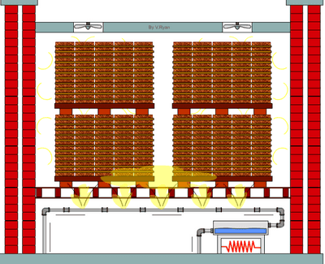

## Seasoning Wood

* The reason that wood has to be dried is for it to **remain strong**.
  * If it is not seasoned, Over the seasons the moisture in it will expand and shrink causing **cracks** in the wood making it **weaker** over time.
* Seasoning wood is the process of **getting rid of the moisture** in the wood
* It is either done **outdoors,** or an **industrial kiln** is used
* When drying wood, it is important to lay it flat to avoid the condition known as **warping**
* It works by having warm air being blown into it
  * The **warm air is being circulated** by fans around the chamber
  * This **warm air dries the moisture out**
* The timber that was dried in a kiln is referred to as “**Kiln Dried**”  
* There are multiple **advantages** of Kiln drying over Natural Air drying:
  * Kiln drying is a lot **faster**
  * Kiln Drying is **fully controlled** and managed
  * A kiln c**an be adapted** (technically, temperature etc.) depending on the timber being dried in it
* However, there are also multiple disadvantages:
  * **A limited number** of timber can be dried at once
  * Timber can sometimes **warp during the process**

