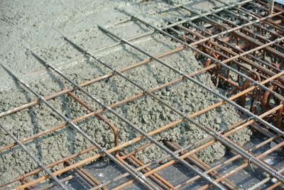
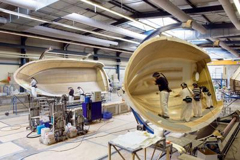
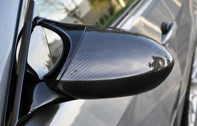
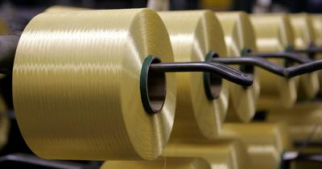

## Composites

* Composites are materials created when **2 materials are mixed together** (Very similar to alloys, however they don’t have to be metallic).
* In a composite, the best properties of a material are mixed with the best properties of another material, creating a “perfect” material for a specific task.
* Most composites are made only of 2 materials mixed in a **ratio**.
* One of the materials is known as **Matrix** (binding material).
* They are used as they provide an **advantage over the traditional material** (stronger, tougher, lighter).

### **Composites list**

1. **Concrete**
2. **Glass-fibre Reinforced Polymers** (GRP)
3. **Carbon-fibre Reinforced Polymers** (CFRP)
4. **Aramid products** (Kevlar)

### **Concrete**

* Concrete is one of the **oldest** Composites.
* Concrete is created by mixing water (Binding material), aggregate (gravel, sand, volcanic ash, small pebbles) and Cement (also a main component in concrete).
* Concrete is commonly used in bridge building and apartment building.
* It possesses **high compression forces** but **lacks** when it comes to **tensile forces**.
* To increase its tensile capabilities, it is **reinforced with rebar** (steel bars)
* The steel bars run along a certain height inside the concrete (along it)

 

### **Glass-fibre Reinforced Polymers** (GRP)

* It is also known as **fibreglass**
* It is made from **strands of glass** which form a **flexible fabric**
* It is mixed with a **resin**, and it is set/cured
* When layered together, the material is **lightweight** but also very **strong**
* **GRP** is the **reinforcement**, while the **resin** is the **Matrix**
* Its methods of production are suitable for **batch production**
* It can be finished by **sanding**, and a finish can be applied to reach a nice-looking surface
* It is used in the boating industry and the manufacturing of swimming pool slides.

 

### **Carbon-fibre Reinforced Polymers (CFRP)**

* One of the most **expensive** composite materials
* **Extremely strong**
* **Lightweight**
* It is made from **carbon fibre** that has been placed **under tension.** The fabric is then **woven together** and coated with a **polymer resin**.
* **Rigid** material once coated and woven
* **High tolerance to heat**
* **Uses:**
  * Formula 1 car bodies
  * Helmets
  * Sports

 

### **Aramid Product (Kevlar)**

* **Flexible**
* Created by combining paraphenylenediamine and terephthanoyl  (You don’t have to remember its chemical components).
* Super strong
* Can be **woven** into clothing/thread
* **10** times **stronger than steel** and **9** times **stronger than nylon**
* **Uses:**
  * Bulletproof vests
  * Protective gear

 