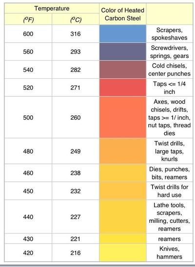
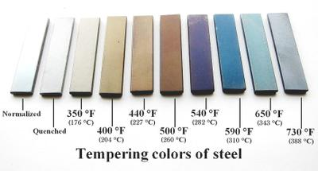
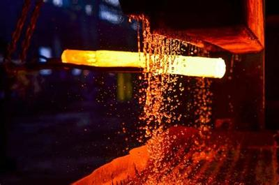

# Preparation of Materials

## Types of Preparations

### **Work Hardening**

* It happens when a metal is **continually exposed to forces** (bending, twisting)
* The forces act over **extended periods** of time
* This can either be beneficial or not
  * Copper piping is heated and then worked on with a planishing hammer. This process work hardens the copper and is beneficial.
  * Duraluminium on an aeroplane being work hardened is a negative as it could fracture and lead to an accident.

### **Annealing**

* Usually done **after** the material has been through the **process of work hardening.**
* The metal is heated to a **desired temperature** and then **cooled in water or sometimes oil.**
* When a metal is heated, it **changes colour**, therefore, you will know when it reaches the right temperature.
* Annealing is done so that the material can be **cut more easily.**
* Annealing does **not involve any action** when the material is hot.
* Some metals **cannot be annealed easily** due to their melting points.

### **Hardening and Tempering of Tool steel**

* It is pretty **similar to annealing**. However, it is done with **different steel grades.**
* A steel object is formed into the shape that is needed and then heated up to the desired temperature and cooled in cold water.
* The tool is then cleaned for the desirable look and feel.
* This process **keeps the strength** of the material and **removes the brittleness.**
* Here is a table of the colours of steel at different temperatures, as well as the uses:

 

* Here is another image with pieces of steel that have been tempered to a precise temperature (note the colour):

 

### **Case Hardening of Mild steel**

* This process hardens only the **outside.**
* It is significantly **easier and less** precise than tempering.
* Typically, the process only **hardens 0.04mm of steel.**
* The steel **retains flexibility** as the centre has not been hardened.
* The process of Case Hardening is as follows:
  * Steel is heated to a **red temperature** (when the steel is red)
  * When the steel is red, it is **plunged into a compound** containing much carbon.
  * After a while, the steel is **reheated** to a glowing red look
  * It is then **placed into cold water** so that it can cool down
* Here is an image showing the compound with carbon poured onto the steel:

 