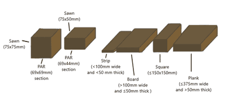
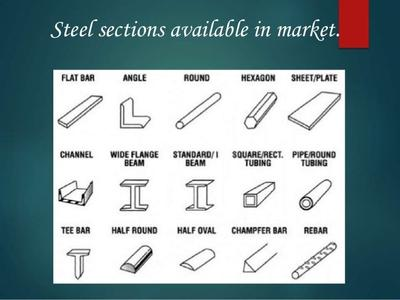
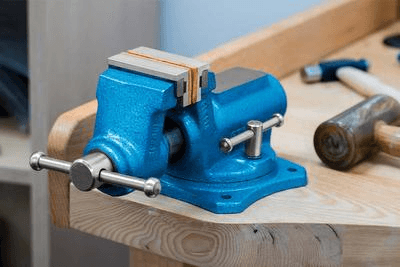
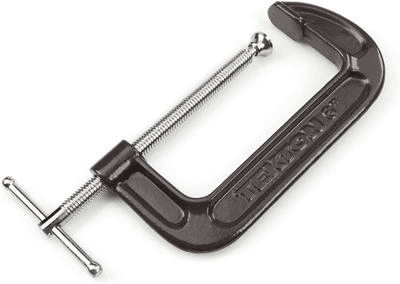
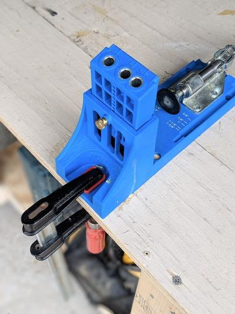

## Market Form, Cutting, Securing

### **Market Form**

* Market form is a general specific size that is available for purchase in hardware stores
* The market form is always the same in every shop
* Market form produces less waste during production as it is specifically cut to a thought-out scale
* Market form materials are efficient as they reduce time and costs
* Here is an image/drawing that represents the available market forms of timber: 

Here is an image that represents available market forms of steel:

 

### **Methods of Cutting**

* When cutting objects, you must consider:
  * The grain (for wood)
  * Thickness
  * Shape
  * Size
  * Toughness of the product
  * Type of the material
* Here is a table representing the tools available to cut a specific material.

| Name of Tool | The material is suitable with | Uses |
|----|----|----|
| Hacksaw | All metals and timber (Although not the best for timber) | Cuts straight lines on the material |
| Guillotine | Sheet metal | Cuts straight lines on the material |
| Tenon Saw | Timber | Can cut precise tenon joints |
| Cross-cut Saw | Timber | Cuts across the grain of the wood |
| Panel Saw | Cutting all types of wood and Sheets of plastic | Cuts straight lines on the material |

### **Portable Power tools**

* Effective at getting the job quickly done off-site
* Simple to work
* Cheaper as material can be cut straight after purchase without the need for transportation
* It is important to follow the manual that has been given with the power tool to prevent any accidents

### **Datum Surfaces**

* ~~A Datum edge or surface is a smooth surface from which precise measurements can be taken~~
* When a material is freshly cut, if it is smoothened, then the surface that was cut and smoothened can be called a Datum Surface
* A Datum surface is always straight; you can check this with a rules or something flat
* Some products will require more than 1 Datum Surface
* On timber, Datum surfaces are known as Face/sides

### **Methods of Securing a Material**

* There are many Securing available devices
* Securing devices need to be used so that the material does not move when being shaped

Securing devices consist of:

* Vices (as shown below)   
* Clamps (as shown below)   
* Jig (as shown below)

 

* The securing Method has to be appropriate to the material dimensions
* Improper securing can lead to material damage or health violations
* When securing, make sure the material is sitting tightly in the tool and does not wobble

