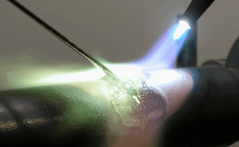
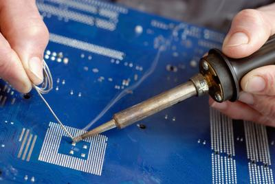
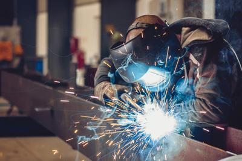
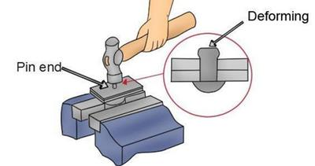
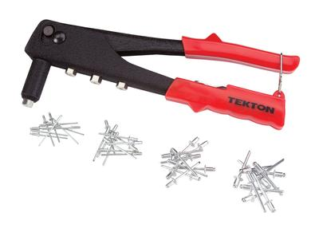
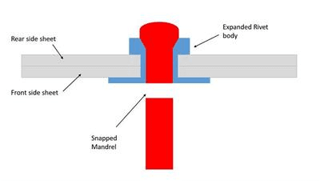

# Joining

## Rivets and Metal Joining

### **Overview**

* When a structure is created, it is important to plan how each component will connect**.**
* There are 2 general types of joining: Permanent and Temporary:
* **Permanent,** derived from the name, is not easily split apart after being joined together.
  * Permanent joining usually involves **heating the material**.
* **Temporary**, however, does **not last** very long and is **easy to undo**.
  * Temporary joining methods include almost everything that can be turned (screws, etc...).
* As viewed earlier (previous section), jigs are holding devices often used when materials are joined together.
* Jigs offer better material stability and give a free pair of hands (very important when joining).

### **Permanent Joinery Methods**

**Brazing**

* Two metals are joined together with a **third metal.**
* The two metals have to have higher melting points than the “joining” metal.
* Process of Brazing:
  * The joining metal is heated in the area that has to be joined with a brazing torch.
  * Once the metal is molten, it is left to cool off in the gaps.
  * The 2 other metals are now joined together.
  * Below is an image of brazing; you can clearly see the “joining” metal.      

**Soldering**

* Soldering is similar to brazing, but metals with a lower melting point are used.
* Due to the fact that the melting point is lower, it is weaker.
* It is often used in circuit boards and electronic components.
* Solder usually has a melting point of around 180-200 C (Degrees).
* Solder is commonly made out of **Tin** and **Zinc,** with sometimes a small addition of Copper.
* Below is an example of soldering:

 

**Welding**

* Welding requires heating to extreme temperatures so that both metals melt.
* The filler prevents the materials from being contaminated/reacting with the air around them.
* There are numerous different types of welding, such as:
  * Metal Inert Gas (Gas)
  * Electric Arc  (Electric Spark)
* Like brazing, a filler material is often used to ensure the process goes well.
* Due to high temperatures, it is important to wear protective gear when welding.

 

**Riveting**

* Riveting is a permanent type of joining material together
* Rivets are considered strong and reliable; they do not “undo” very easily
* Riveting is used to join 2 or more metal units
* The process of riveting is fairly simple:
  * A hole slightly bigger than the diameter of the rivet is drilled through the metal
  * A rivet (which is a metal tube with a pin-like ending at the end) is inserted
  * Then, the second smooth end is deformed via a rivet gun
  * The rivet joint is now secure
* Rivets are commonly used to join metals such as Copper, Steel and Aluminium
* Riveting is commonly used in shipbuilding and Aircraft Manufacturing
* Below is the process of riveting (once the head and tube were inserted, as you can see in the zoom-in, the end is deformed)

 

* Here is an example of a rivet gun (it uses air pressure and the deformation process to secure the Rivet):

 

**Pop Riveting**

* Pop riveting is a newer method
* It uses a Rivet gun (as shown above in the picture)
* The process is only done through 1 side. This is an advantage as it can be applied where only 1 side is accessible
* The pop rivet has a softer part, which means that with pressure from the rivet gun. It deforms and secures the material
* In the pop rivet, the mantle (long bit) breaks off after the end is deformed, leaving a clear rivet
* Here is a picture of the process:  
* The red is the original rivet that was inserted, while the blue bit shows the expansion and change of the rivet shape after it has been processed.
* **“I have attached a 2 videos in useful resources, I strongly recommend watching them!”**

