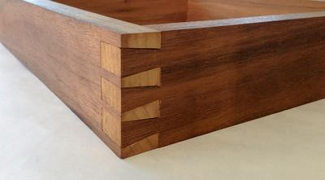
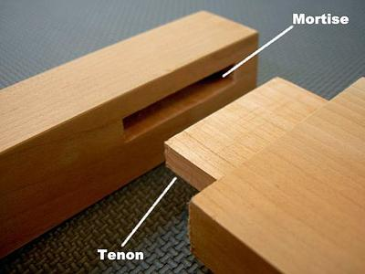
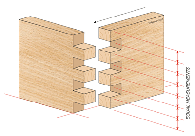
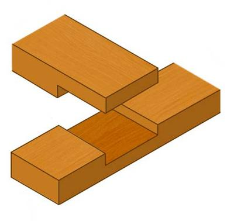
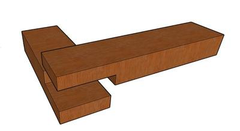
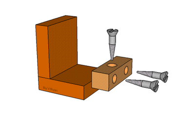
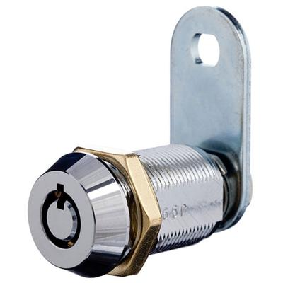
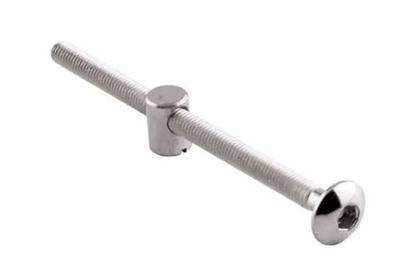

## Wood Joining

**~~Wood Joints~~**

* Wood joints are stronger than using adhesives to Join 2 pieces of wood
* Joints look nice on a finished product; they offer the product a more premium look (some might consider using joints to Join timber for their coursework)
* Some joints need adhesives to keep them secure; however, most do hold on to their own

Here are some of the basic joints that you are required to know: (images will be below the table)

| Name | Uses | Advantages | Disadvantages |
|----|----|----|----|
| Dovetail Joint (1) | Expensive furniture, Drawers and Cupboards | It is extremely strong and, in some cases, does not require adhesive. It is also not visible from the front view. Considered one of the prettiest joints. | It is complicated to create as it requires very precise measurements. It is also quite expensive as it takes a long time to make. |
| Mortice and Tennon (2) | Housing Frames and different frames, sometimes in furniture. | It is considered pretty, as nothing is visible. It is also a very strong method of joining timber planks together. | It is complicated to create small objects. Usually requires the use of adhesive to reinforce further. |
| Finger and Comb (Similar to dovetail but flat) (3) | It is used in picture frames and jewellery boxes. | It is very simple to assemble and is considerably strong at certain angles. It forms perfect right angles (which can be useful for boxes). | It has very limited flexibility and breaks at most angles. It is time-consuming to create as it has a complicated pattern. Most of the time, an adhesive is used. |
| Cross Halving (4) | Rarely used in simple boxes, most commonly used in low-cost frame construction. | It is relatively strong and versatile. It is very simple to assemble together and simple to make. | These joints move sometimes, which causes damage to the structure and worsens the aesthetics. Requires Adhesive. |
| Lap joint (similar to Cross Halving) (5) | It is commonly used for frames and furniture. | It is more or less strong and versatile. It is also simple to assemble together and requires little time to make. The joint is not very easily visible. | An adhesive is required. It is not the strongest joint that exists. |

* The pictures will go in the order of the joints in the table:
* Dovetail Joint (1):

   
* Mortice and Tennon Joint (2):

   
* Finger and Comb Joint (3)

   
* Cross Halving Joint (4):

   
* Lap Joint (5):

   
* These are the 5 joints that you are required to know.

**Knock-Down Fittings**

* These joints do not require precise cutting or any adhesive.
* These joints increased in popularity as home-buildable furniture increased in popularity.
* They are strong, non-permanent joints.
* They were made to lower the number of fittings used (universal fitting).
* They are separated once joined via the screws.
* The corner joints include Block joints, Two-piece corner block joints, Scan fittings, and Cam locks.
* Cam locks are the most common fittings for manufacturing boards.
* Scan fittings are considered the most secure type.
* Here are images of the fittings:

 

* This is a Block joint (most common) ^

 

* This is a basic CAM lock

 

* Scan fitting 

