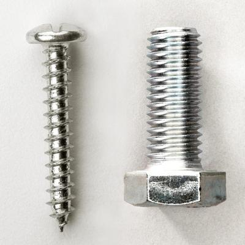
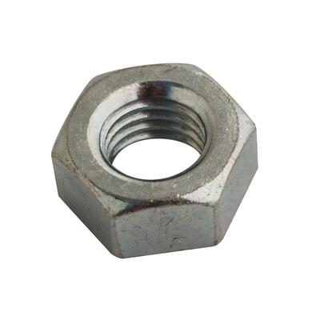
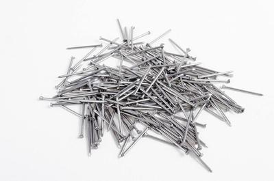
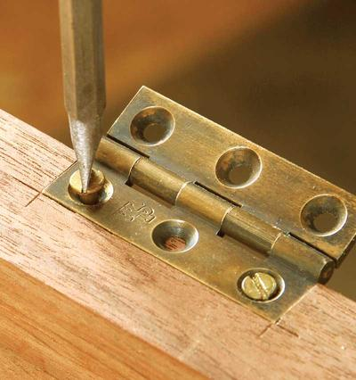
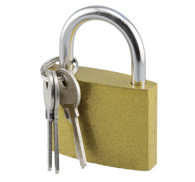
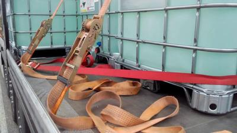
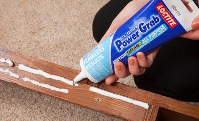

## Pre-Manufactured Pieces

### **Overview**

* Pre-manufactured components would be anything that is made at a factory and is already prepared for you to join
* These include things like bolts, screws and nails

### **Screws & Bolts**

* Bolts are flat headed while screws have a bump
* Bolts have a flat ending, while screws have a sharp ending
* Bolt are usually a lot thicker than screws
* Bolts are made to have a nut installed, while screws arent
* Screws are not made to be used in metal joining
* Here is an image to visualize the difference (the left is a Screw, the right side is a bolt):

 

* Screw as tightened with screwdrivers
* There are many types of screwdrivers, such as the Philips Screwdriver
* The reason screws come in different shapes is to prevent the removal by a casual person
* The size of a screwdriver is measured in gauges, which is a measurement of the diameter of the metal
* Here is a table of all the common gauges (Diameters):

| Diameter |    |
|----|----|
| Gauge | Metric (mm) |
| 2 | 2.0 |
| 3 | 2.5 |
| 4 | 3 |
| 5 | 3.5 |
| 6 | 4 |
| 8 | 4.5 |
| 10 | 5 |
| 12 | 5.5 |
| 14 | 6 |

* *I suggest memorizing the patterns instead of the precise table* :smile:
* For the nuts and bolts measurements, these are much easier
* They are measured in millimetres and have the letter M before it
* An example would be a nut that has a measurement of 8M\*30mm
  * This means that it is 8mm in diameter and 30mm in length
  * This is the case for every nut and bolt (the M and that style of measurements)
* Nuts also come in various sizes to apply for the bolts
* Here is an example of a nut:

 

### **Nails**

* Nails are common to join timber
* They are small, easy to use and strong
* They are primarily used to join softwoods. However, hardwoods are joined by nails sometimes too
* There are 2 primary types of nails, but various sizes
  * Oval Wire nails are oval (slightly), which means that they have a lower chance of splitting wood along their grain
* Panel Pin nails are the most common types, and they are just simple nails (small and light)

   

### **Hinges**

* Hinges connect 2 bits of material that need movement
* They come in various sizes and shapes
* They can be secured by nails or welding
* Some hinges carry out a task, and some are just for beautification
* Below is an example of a hinge:

 

### **Locks**

* Locks are usually made to prevent unauthorized access
* There are locks with keys and locks without
* Some locks simply hold stuff together
* Alternatively, some locks keep things secure
* Below is an example of a lock:

 

### **Catches**

* Catches are simple to secure and release (one of the simplest methods)
* They are very reliable
* They are not very strong and securing objects
* Catches are very cheap and cost effective
* Examples where catches could be used are:
  * Securing loads on truck trailers
  * Locking together tool boxes
  * Furniture; to open and lock doors
* Here is an example of a Catch:

 

### **Adhesive**

* It is very different compared to the other methods that were listed
* No mechanical parts are used
* It joins material through glueing
* An example of an adhesive could be “Resin”
* Remember that adhesives must be set and are not instant
* Safety precautions:
  * Ventilate the room when working with strong adhesive
  * Keep adhesives off your skin and eyes
  * Wash your hands after using adhesives
  * Preferably use gloves
  * Keep adhesives away from small children
* Here is an example (picture) of ah adhesive:

 

* Here is a table of the most common adhesives:

| Name | Uses |
|----|----|
| Acrylic Cement | Used for the joining of plastics, it melts the surface and fuses them together |
| Contact Adhesive | Used for joining plastics and woods |
| Epoxy Resin | Used for joining metals and plastics |
| PVA (Polyvinyl Acetate) | Used for wood, it is water-resistant |
| Synthetic Resin | Used for timber where PVA isn’t an option, needs to be premixed |

