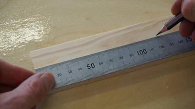

# Setting, Measuring and Making

## The Basics of Setting, Measuring and Making

### **Setting and Measuring**

* Measuring and setting is the beginning of a manufacturing process
* Measuring is done on the product before any tools are used to shape it
* It is essential as the measurement has to be precise for the product to work
* If a product has inaccurate measurement, it will lose its quality and potentially lead to mechanical issues

It is always a good idea to double-check your measurements before manufacturing

### **Marking**

* Marking is another essential task for the product to be high-quality and precise.
* Marking involves transferring the measurement onto the material to ensure you shape it along your guidelines.
* Marking is great when using hand tools as it offers a more precise approach to manufacturing.
* When marking, always consider the width, length and thickness of your piece (to make sure you mark it on all 3 points)
* When marking, it is best to use a pencil when working with wood
* Here is an example of marking:

 