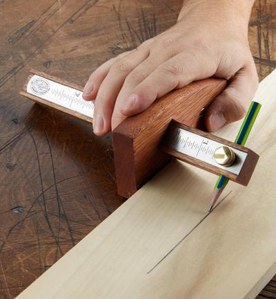
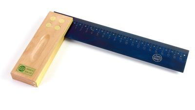
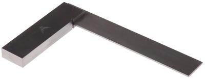
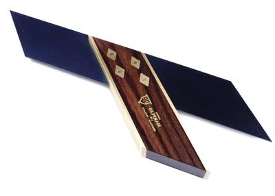
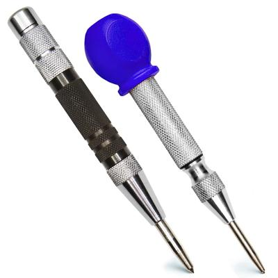
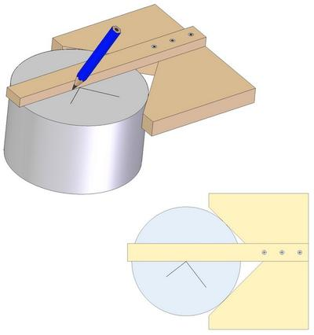
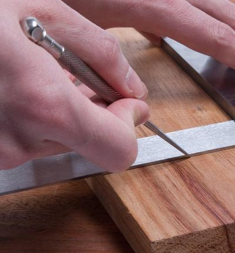
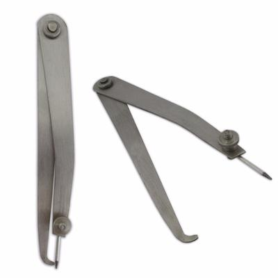

## Tools for Measuring and Making

### **Proper Tools**

* It is essential to use the correct tools on the correct surfaces when measuring and marking
* The most common surfaces you will encounter are:
  * Wood (Timber)
  * Plastics
  * Metals
* Below is a basic table on what tools should be used on which surface:

| Type of Marking | Wood (Timber) | Plastic | Metal |
|----|----|----|----|
| Straight Line | Pencil or marking knife | Permanent Marker | Straight steel edge and scriber |
| Parallel Line | Marking gauge | Odd-leg calipers | Odd-leg calipers |
| Perpendicular line (90 degrees) | Try square | Try square | Engineers square/ Try square |
| 45-degree angle | Mitre square | Mitre square | Mitre square |
| The centre of a hole | Sharp pencil and Center punch | Permanent marker | Centre punch |
| The centre of a round object | Centre square | Centre square | Centre square |
| Arches, Curves and Circles | A pair of compasses | Dividers | Dividers |
| Irregular shape | Template | Template | Template |
| Mortice and Tennon joint | A mortise gauge | - | - |

Here are examples of these tools in pictures:

* Below is a Marking gauge:

 

* Below is an example of a Try square:

 

* Below is an example of an Engineers Square:

 

* Below is an example of a Mitre Square (45 degrees):

 

* Below is an example of a Centre Punch:

 

* Below is an example of a Centre Square:

 

* Below is an example of a Scriber:

 

* Below is an example of an Odd-leg Caliper:

 