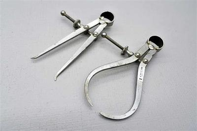
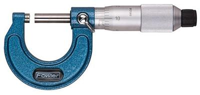
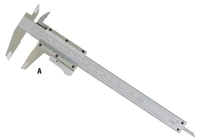
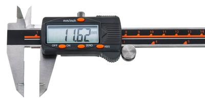

## Precise Measuring Instruments

### **Instruments**

**Inside and Outside Calipers**

* They are used to measure the inside and outside of a material
* They measure the width
* Here is an example of Inside/Outside Calipers:

 

**A micrometer**

* Used to measure the thickness of a very thin material
* It is extremely precise and accurate
* It can be challenging to use
* ~~“*Used to be in the physics syllabus.*”~~
* Here is a video on how to read a micrometer screw gauge (micrometer): <https://www.youtube.com/watch?v=vl-51zYDg10>
* Here is an example of a micrometer:

   

**Vernier Caliper**

* It is also used to measure the thickness of a very thin material
* Can measure to a high level of precision
* Easy to read
* Can measure external distances and internal
* **It can come in digital and analog form**
* ~~“*Used to be in the physics syllabus.*”~~
* Here is a video on how to read a Vernier Caliper: <https://www.youtube.com/watch?v=4hlNi0jdoeQ>
* Here is an example of a Vernier caliper:

   

* Below is an example of a digital caliper:

   

