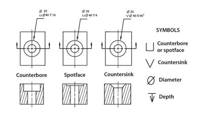

## Shaping (Continued)

### **Computer Aided Manufacturing**

* It is also worth knowing that Computer Aided Manufacturing (Automated system) typically removes material to shape a product
* Some examples of CAM include:
* Laser cutters, Milling machines, Routing machines, Lathe machine

### **Drilling**

* Drilling is making a hole in/through a material
* A drill is used to make holes
* There are different types and sizes of drills
* Drilling can be useful as it is simple and efficient
* It can be done with a hand tool or a power tool (pillar drill)
* Below are some types of drilling that you are required to know:

1. **Pilot hole**

   
   1. It is smaller than the screw or the bolt that is being used
   2. It secures the screw as the screw is smaller
2. **~~Clearance hole~~**

   
   1. It is larger than the screw or bolt that is being used
   2. The screw does not rub against the sides
3. **Tapping**

   
   1. A hole is drilled, then a screw with hexagonal edges is inserted (it is called a tap)
   2. The hexagonal edges secure themselves into the hole
   3. This method is very secure and reliable
   4. It can be secured via a tap wrench

### **Countersunk Hole vs Counterbored Hole**

* Below is an example of a countersunk hole vs a counterbored hole (ignore the spotface hole) :

 

* The main difference is that the edges of the counterbore hole are flat
* The edges on a countersink hole are cut at 90 degrees
* This is the main difference

