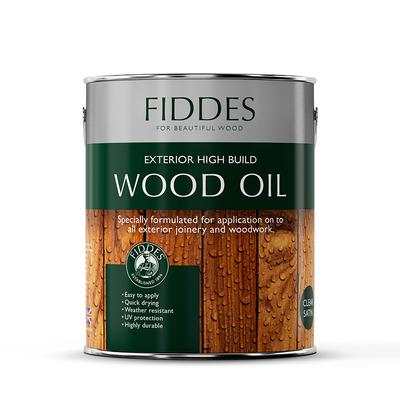

# Finishes

## Overview

* Finishes are the last step of product manufacturing
* Some materials require finishes (Timber), and some self-finish (like moulded plastic)
* A finish is applied to gain an advantage, such as making the material waterproof)
* Materials are coated with a finish mainly for 2 reasons:
  * Protection
  * Aesthetics
* Examples of finishes are Paint, Oil, Galvanising
* Below is an example of an oil finish (for timber):

   

### **Different Finishes**

* Many types of finishes exist
* When applying a finish, you have to consider the material and the purpose of applying the finish
* Below is a table of some **Metal** finishes, processes of application and reasons for application:

| Finish Name | Material | Process of Application | Reason for Application | Example of product |
|----|----|----|----|----|
| Galvanising | Iron, Steel | It is applied through a chemical process that coats the material with zinc. | Zinc provides good rust and weather resistance | Nails, Nuts, locks, bolts, screws |
| Anodising | Aluminium, Titanium | It is applied via electrolysis | It increases the resistance against corrosion and adds the ability to add colour | Flashlights, phones, cookware |
| Electroplating | Iron, Steel | It is applied via electrolysis. The process adds layers of nickel above the metal. | The added layers help prevent rusting and weather corrosion | Engine parts, some motorbikes |
| Paint | Any metal | Spraying or brushing | Prevents weather corrosion and makes the product look nicer | Postboxes, Metal gates, fences |
| Oil/grease | Any metal | Spraying or rubbing onto the surface | Prevents corrosion and applies a protective layer | Metal structures |
| Polish | Any metal | By hand using a cloth or via machine buffing | Aesthetics adds a shine to the metal | Jewellery, copper, bronze |
| Plastic Dip coating | Any metal | The product is dipped into a tank with a thermoplastic and is left to cool after | To make it weather-resistant and enhance safety features (holding etc.) | Plastic coated handles |
| Powder coating | Any metal | A powder is applied via an electrostatic gun. The powder is then melted and left to cool on the metal. | Adds a protection layer to the metal | Washing machines, freezers |

* Below is a table of some Wood (Timber) and Plastic finishes as well as the reasons for application:

| Finish Name | Material | Process of Application | Reason for Application | Example of product |
|----|----|----|----|----|
| Wax polish | Any wood | Applying by hand with a cloth or buffing | It adds a shine to the product and a nicer aesthetic appearance | Interior doors, furniture |
| French polish | Hard woods | Several thin layers are applied with a cloth or by hand | It adds a shine to the wood | Expensive furniture |
| Varnish | Any wood | Sprayed or brushed onto timber | It protects the wood and give a nice aesthetic appeal | Boat decking |
| Wood stain | Any wood | Sprayed or brushed onto the timber | To apply color or bring out visually the grain in the wood | Interior and exterior furniture |
| Exterior wood stain | Any wood | Sprayed or brushed onto the timber | Adds a protective layer for the wood | Sheds and garden furniture, fencing panels |
| Oil | Any wood | Sprayed onto the surface or applied with a cloth | Adds a layer of protection from weathering and enhances the aesthetic properties of the product | Traditionally on cricket ball and cooking equipment |
| Paint | Any wood | Sprayed or brushed onto the timber | Adds a protective layer and improves the visual appeal | Door frames, Internal doors |
| Cellulose Sealant | Any wood (best for MDF) | Sprayed or brushed onto the timber | To seal a surface before another finishes is applied on it | Internal furniture |
| Buffing compound/polish (**only plastic** **finish you  need to know**) | Injection molded or shaped plastics | Buffing wheel or hand polished with a soft cloth | Removes sharp edges, removes static dust and adds shine that enhances the visual appearance | Children’s toys |

* When applying a finish you need to consider two important aspects:
  * The material
    * It is important that an appropriate finish is selected for a certain material, you need to know the function that the product will serve. Some finishes could damage the material so it is important to select the right one
  * The function
    * It is important to know the function to select the correct material, if you know a product will be outdoors for a long time then perhaps it needs to be coated with a water proof or water resistant finish

### **Self-Finishing Materials**

* Most of the self finishing materials are plastic based
* These are material that do not have to be coated with a finish
* An example of that is Gortex it is a self finished fabric that is waterproof, hence the reason why it is used in shoe making
* A common use for self finished materials is safety equipment 

### **Health and Safety**

* It is important to read the instructions before working with any finish
* Some finishes can be harmful 
* Make sure to wear safety equipment such as gloves or a air ventilation system (when working with strong paints in a closed off space)
* Try to ventilate the room when working with finishes
* Keep finishes and other dangerous liquids away from children
* Be aware of the environment when working with finishes

