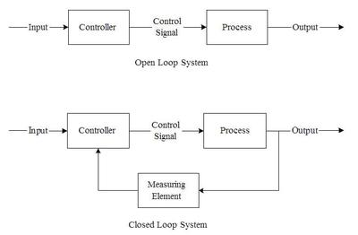

# Basic System Concepts

## System Concepts

### **Systems**

* A system is defined by inputs, processes, and outputs
* Many electronics in the current day world use some system. (e.g., A button is pressed to lower the temperature of the room, a process is executed, and colder air comes out)
* Many devices use multiple systems at once (such as cars or mobile phones)
* For drawing systems, a special notation is used

### **Open-Loop vs Closed-Loop System**

* There are 2 types of systems: Open and Closed (loop)
* An Open system is just a direct system that goes:  **Input → Process → Output**
* A Closed system has data being fed from the output to the input as a method of double-checking or controlling
* It is similar to: **Input → Process → Output → Input (Feedback stage)**
* Below is a diagram to compare Open-Loop to Closed-Loop systems:

