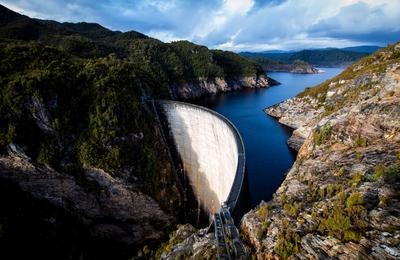
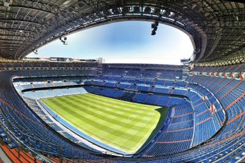

# Mechanics

## Structures

**Mass Structures**

* Mass structures rely on their mass to support them
* They are usually very heavy and take up a lot of space
* They are typically built out of stone or concrete
* Mass structures are considered to be one of the strongest and oldest types of structures
* Examples of mass structures can be:
* The Gordon Dam in Australia

 

**Frame Structures**

* Frame  structures are created by connecting thin pieces of material
* The thin pieces work together to support the mass of the structures
* Frame structures provide a stable frame for the building, giving a lot of indoor space
* Not a lot of material is needed to create large frame structures
* Common materials of frame structures include Steel or Iron
* Frame structures are commonly used in Large shopping centres and Sports stadiums
* An example of such a structure can be:
* Santiago Bernabeu Stadium in Madrid

 

**Shell Structures**

* Shell structures are usually made up of thin sheets of material
* The material commonly used for such sheets is steel or carbon fibre
* They can be strengthened by bending such sheets in a unique pattern
* Usually, they do not enclose large spaces as the frame or mass structures but are good at protecting the space inside the “shell.”
* An example of a Shell structure can be:
* McLaren Artura

 