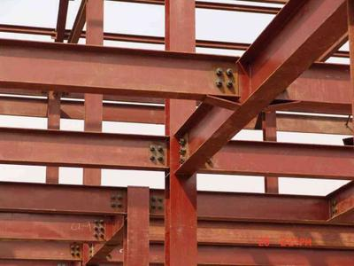
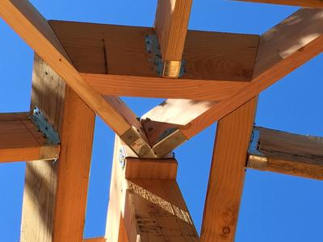
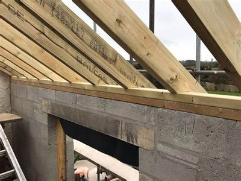

## Types of Frame Structure Members

### **Introduction**

* Frame structures are split into parts called “members”
* All of these work together to sustain the load
* A frame structure would not be able to hold the load if some members were to be missing
* There are 4 main members:
  * Beams
  * Ties
  * Struts
  * Columns

### **Beams**

* A beam is a horizontal piece of material that is supported either on both or only one side
* Beams are designed to withstand bending forces
* Usually, a load is positioned on top of a beam (but not always)
* Below is a picture of a beam:

 

### **Ties**

* A tie is a beam pointing down at a 45° angle
* Ties are designed to resist tension forces
* They can be made from solid steel bars or cables
* Below is an example of a tie:

 

### **Strut**

* A strut is a beam pointing up at a 45° angle
* Struts are designed to resist compression forces
* Concrete is commonly used to make struts
* Below is an example of a strut:

 

### **Columns**

* Columns are vertical pieces of material
* They are designed to resist compression forces and support loads
* Steel and concrete are common materials that are used to make columns
* Below is a picture of a column:

 