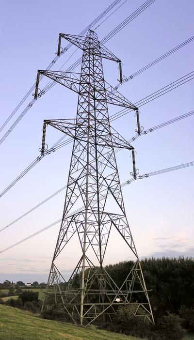
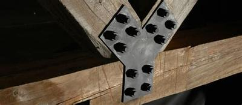
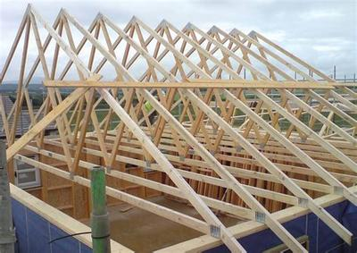
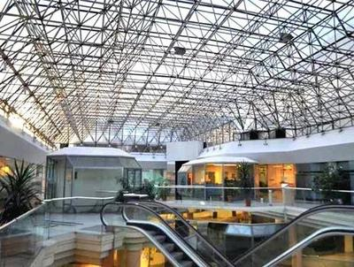

## Making Frame Structures Stronger

### **Triangulation**

* Triangles are the strongest shapes
* Each point supports the other point
* Below is an image of an electrical tower (look at the triangles):

 

### **Gusset Plates**

* Gusset plates are plates of metal that are attached at the joints between Structural components
* Gusset plates are usually made out of steel
* They are bolted to the other components
* They add a lot of structural integrity to the structure

   

### **Trusses**

* Trusses are combinations of structural components that together create a formation to support masses
* Trusses are commonly used in housing roofs and bridges
* Trusses use ties and struts very often
* They also combine triangulation

 

### **Space Frame**

* Space frames are many trusses supported on pillars
* They are commonly used in supermarkets to enable a lot of space to be created
* They can be large and very lightweight

 